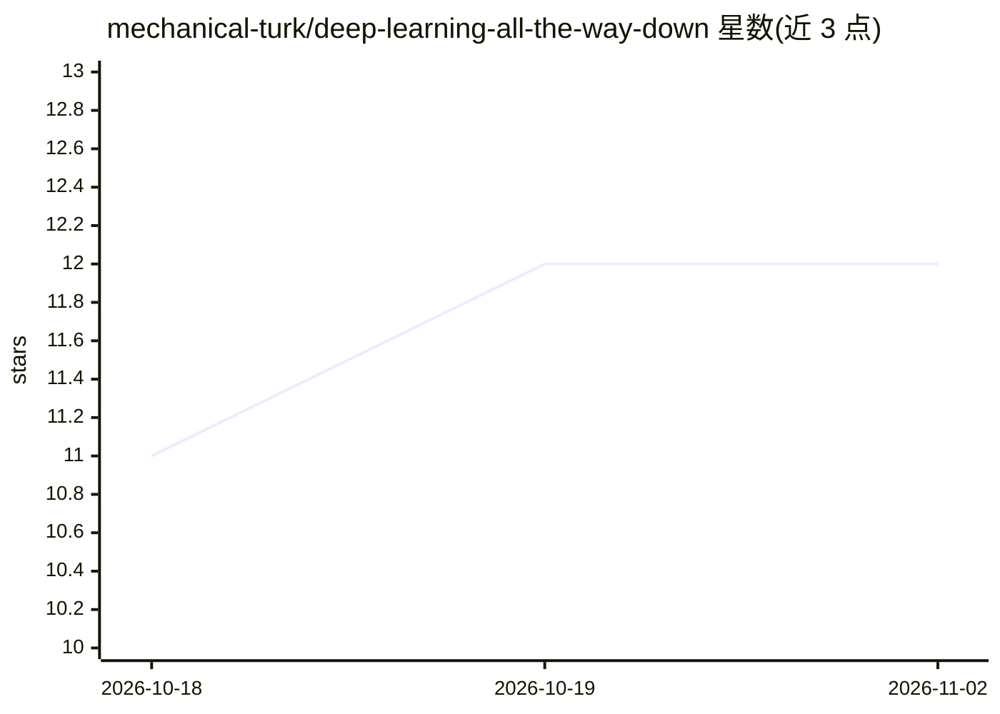

# mechanical-turk/deep-learning-all-the-way-down

⭐ 12 · C++ · 推送 2026-10-22 · [GitHub](https://github.com/mechanical-turk/deep-learning-all-the-way-down) · [官网](https://www.youtube.com/playlist?list=PLZSg76FHvdTw) · 组织维护

**用现代 C++ 从第一性原理构建深度学习的教学代码系列**

配合 YouTube 视频系列的 code-first 教学仓库：每集对应一个 Git commit，从张量存储、逐元素运算、广播、矩阵乘法，逐步构建反向模式自动微分、神经网络层（Linear/Tanh/ReLU/Residual/Sequence），直到用 softmax 与交叉熵在 MNIST 上训练多层感知机。代码为 C++23，仅依赖标准库，可用 Clang 或 GCC 编译运行，每集程序用断言自检。README 明确声明这是教学实现，不是生产框架，也不试图替代 PyTorch；GPU 编程与 CUDA 内核为后续规划章节。

## 筛选速览

| 维度 | 判定 | 备注 |
|---|---|---|
| AI 角色 | `ai-knowledge` | 知识聚合/清单类 |
| 许可风险 | `none` | — |
| 部署形态 | `None` |  |
| 模型依赖 | — | README 未给出锁定关系 |
| 硬件要求 | — | 无带数字的原话,不猜 |
| 安装摩擦 | `high` | 编译与系统依赖俱全 |
| 成熟度 | `idea` | |

## 能力要点

- 每集以 Git commit 保存屏幕上编写的代码，可检出历史版本
- 实现张量运算、NumPy 风格广播与反向模式自动微分（标量与张量两级）
- 可组合的 Layer 接口与 Sequence 容器，支持残差连接与嵌套
- C++23 单文件程序，仅依赖标准库，MNIST 示例含脚本下载数据

## 适用场景

- 想理解 PyTorch 等框架内部数学与数据结构的开发者按集学习
- 对照 commit 逐步阅读并运行每集的自包含代码
- 作为 C++ 实现张量、autograd 与训练循环的参考代码

## 场景标签

`教程课程` · 领域:学习与行业

## 证据(README 行号)

> L5: Build the foundations of deep learning from first principles in modern C++.
> L15: Each episode ends with a Git commit that preserves the code written on screen.
> L48: This is an educational implementation, not a production framework or an

## 星数曲线

2026-10-18 11 → 2026-11-02 12（+1）

---
*卡片 v1 · prompt 1.4 · 生成 2026-11-01 · 置信度 high · 依据 README sha `92ab45617012` · [字段定义](../../DATASET.md)*
