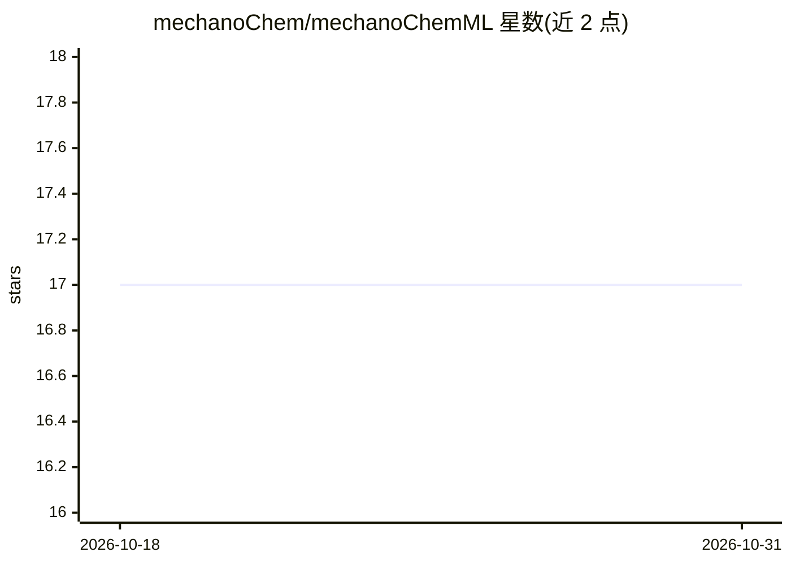

# mechanoChem/mechanoChemML

⭐ 17 · Python · BSD-4-Clause · 推送 2026-01-16 · [GitHub](https://github.com/mechanoChem/mechanoChemML) · 组织维护

**计算材料物理的科学机器学习库：连接 ML 平台与偏微分方程求解器**

由密歇根大学计算物理组开发的机器学习软件库，定位为科学机器学习平台与偏微分方程物理模型求解平台之间的接口，聚焦计算材料物理，涉及材料输运、反应、相变、力学、热输运与电化学的耦合求解。通过 PyPi 发布，安装与使用说明见 readthedocs 文档，采用 BSD 4-Clause 许可证。可引用的 arXiv 预印本（2021）记录了该库的设计。

## 筛选速览

| 维度 | 判定 | 备注 |
|---|---|---|
| AI 角色 | `ai-ecosystem` | LLM/agent 周边工具 |
| 许可风险 | `viral` | BSD-4-Clause |
| 部署形态 | `library` | 以包/库形式分发 |
| 模型依赖 | — | README 未给出锁定关系 |
| 硬件要求 | — | 无带数字的原话,不猜 |
| 安装摩擦 | `low` | 无编译、无系统依赖或容器化 |
| 成熟度 | — | 结构信号不足 |

## 能力要点

- 作为科学 ML 平台与 PDE 物理求解平台之间的接口层
- 面向计算材料物理中的多物理场耦合问题
- 以 Python 库形式在 PyPi 发布

## 适用场景

- 在材料物理仿真中引入机器学习方法
- 构建涉及输运/反应/力学/电化学耦合的模型工作流
- 科研场景下复现与引用相关方法

## 场景标签

`科研工具` · 领域:学习与行业

## 证据(README 行号)

> L20: mechanoChemML is a machine learning software library for computational materials physics. It is designed to functio
> L3: Developed by the Computational Physics Group at the University of Michigan.

## 星数曲线

2026-10-18 17 → 2026-10-31 17（+0）

---
*卡片 v1 · prompt 1.4 · 生成 2026-10-30 · 置信度 mid · 依据 README sha `7f5bdc9fa9cb` · [字段定义](../../DATASET.md)*
