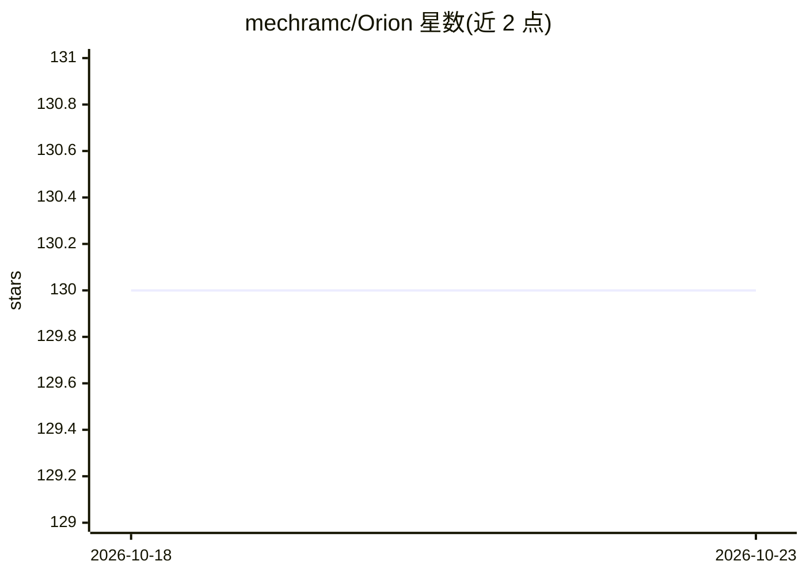

# mechramc/Orion

⭐ 130 · Objective-C · MIT · 推送 2026-08-23 · [GitHub](https://github.com/mechramc/Orion) · 个人维护

**在 Apple 神经引擎上直接训练与推理小 LLM 的本地运行时**

面向 Apple Silicon 的本地 AI 运行时：绕过 CoreML/Metal，通过私有框架（_ANEClient、_ANECompiler、MIL IR）直接驱动 Neural Engine，实现小 LLM（GPT-2 124M、Stories110M）的设备端离线训练与推理。关键机制包括图 IR 编译器生成 MIL、delta 编译（免重编译的权重热更新）、LoRA 热交换、程序缓存与基准测试工具。训练在 1,000 步内验证零 NaN、无内存泄漏。限制：依赖逆向工程的私有 API，支持模型种类少，pip 安装与 Python 封装为规划项。

## 筛选速览

| 维度 | 判定 | 备注 |
|---|---|---|
| AI 角色 | `ai-ecosystem` | LLM/agent 周边工具 |
| 许可风险 | `permissive` | MIT |
| 部署形态 | `library` | 以包/库形式分发 |
| 模型依赖 | — | README 未给出锁定关系 |
| 硬件要求 | — | 无带数字的原话,不猜 |
| 安装摩擦 | `low` | 无编译、无系统依赖或容器化 |
| 成熟度 | — | 结构信号不足 |

## 能力要点

- 绕过 CoreML，经私有框架直接访问 ANE 实现训练与推理
- delta 编译使权重更新免重编译（4,200ms→494ms）
- LoRA 适配器作为 IOSurface 输入，热交换零重编译
- 图 IR 编译器（~27 ops、优化 pass、13 个前端）与内核级基准测试套件

## 适用场景

- 在 Mac/iPad/iPhone 上离线运行私有 LLM
- 在设备端对小模型做 LoRA 微调与训练实验
- 逆向工程视角下对 Apple Neural Engine 做性能测量与约束研究

## 场景标签

`微调` `推理引擎` · 领域:训练与推理

## 证据(README 行号)

> L3: **A local AI runtime that enables training and running small LLMs directly on Apple Silicon using the Neural Engine.
> L35: Orion bypasses CoreML entirely. It talks to the ANE through private frameworks (`_ANEClient`, `_ANECompiler`, MIL I
> L54: **Orion's niche**: the only framework that targets Apple's Neural Engine directly for both training and inference. 

## 星数曲线

2026-10-18 130 → 2026-10-23 130（+0）

---
*卡片 v1 · prompt 1.4 · 生成 2026-10-22 · 置信度 mid · 依据 README sha `9b7aa213a48b` · [字段定义](../../DATASET.md)*
