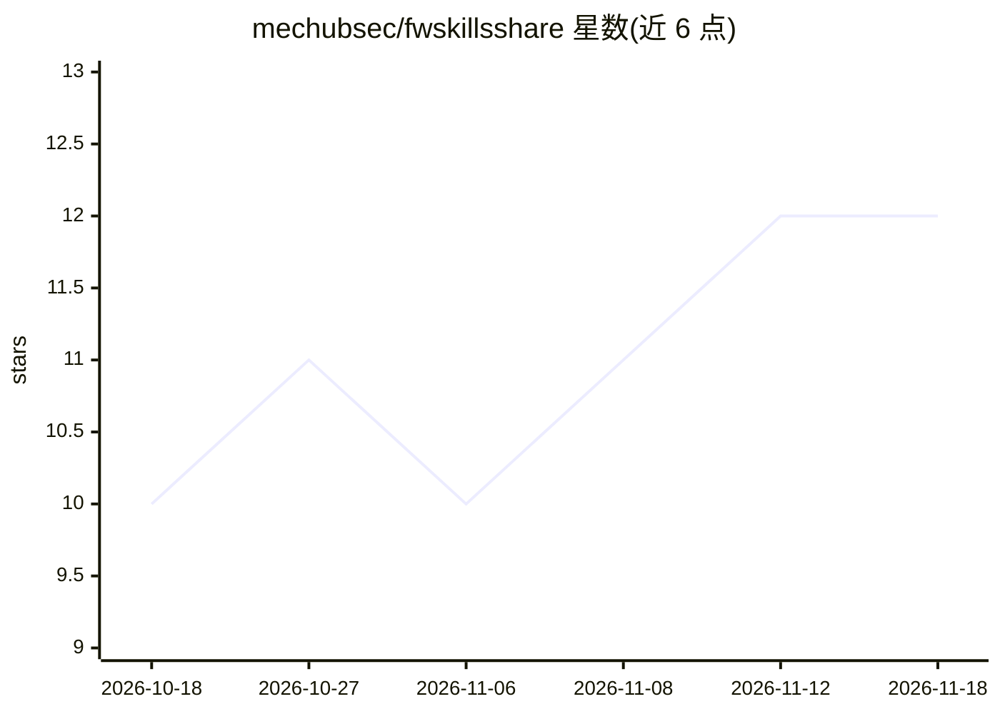

# mechubsec/fwskillsshare

⭐ 12 · Python · MIT · 推送 2026-11-15 · [GitHub](https://github.com/mechubsec/fwskillsshare) · [官网](https://mechub.org) · 组织维护

**面向防火墙/网络安全工程师的 34 个 agent 技能合集**

为编码 agent 提供的防火墙与网络安全技能合集，覆盖 Juniper SRX 策略/NAT/VPN/MNHA 运维手册、Cisco/Fortinet/Palo Alto/SRX 四厂商配置解析（统一中间 schema）、跨厂商审计/转换/diff 工具，以及 PCI/HIPAA/CMMC/CIS/ISO 27001/SOC 2/DISA STIG 的控制项到证据映射。安装脚本对技能文件做 SHA256 校验且仅接受 release tag；技能可装入 Claude Code、Codex 或 Hermes，由模型按关键词自动调用或显式 /skill 调用；26/34 包已完成两阶段评审，其余标记为 draft。

## 筛选速览

| 维度 | 判定 | 备注 |
|---|---|---|
| AI 角色 | `ai-knowledge` | 知识聚合/清单类 |
| 许可风险 | `permissive` | MIT |
| 部署形态 | `None` |  |
| 模型依赖 | — | README 未给出锁定关系 |
| 硬件要求 | — | 无带数字的原话,不猜 |
| 安装摩擦 | `low` | 无编译、无系统依赖或容器化 |
| 成熟度 | — | 结构信号不足 |

## 能力要点

- 34 个技能分五族：四厂商解析器、SRX 运维手册、跨厂商工具、合规手册、安全管理/NAC 部署
- 统一中间 schema 支持跨厂商配置转换与语义级 diff
- install.sh 逐文件校验 SHA256，拒绝在非 release tag 上运行
- 设备写入操作带逐阶段审批门与 confirmed commit 机制（手册内描述）

## 适用场景

- 让编码 agent 按厂商正确语法解析、审计、转换防火墙配置
- SRX 高可用（MNHA）/IPsec VPN 的分阶段部署与割接
- 为防火墙配置生成 PCI/HIPAA 等合规审计证据

## 场景标签

`网络安全` · 领域:学习与行业

## 证据(README 行号)

> L13: Agent skills for the firewall work you actually do — parsing, auditing, converting, running Juniper SRX, and deploy
> L59: **34 skills** across five families. All of them are **model-invoked** — the agent reaches for them automatically wh

## 星数曲线

2026-10-18 10 → 2026-11-18 12（+2）

---
*卡片 v1 · prompt 1.4 · 生成 2026-11-18 · 置信度 high · 依据 README sha `4187f2f0fc14` · [字段定义](../../DATASET.md)*
