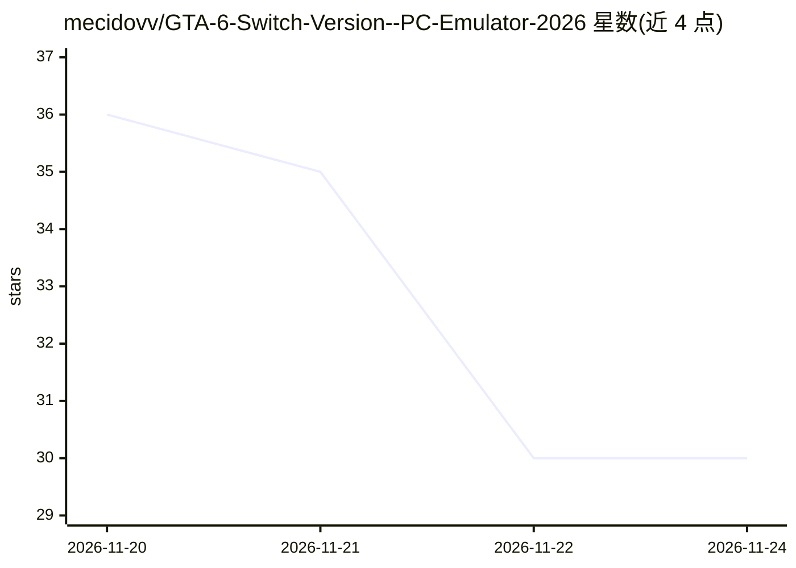

# mecidovv/GTA-6-Switch-Version--PC-Emulator-2026

⭐ 30 · Rust · Apache-2.0 · 推送 2026-11-21 · [GitHub](https://github.com/mecidovv/GTA-6-Switch-Version--PC-Emulator-2026) · 个人维护

**面向 Windows 玩家的 GTA VI PC 版安装准备与配置指南**

一个针对尚未发布 PC 版的 GTA VI 的 Windows 准备资源，内容为指南与清单：Windows 更新、GPU 驱动（NVIDIA/AMD/Intel 官方驱动链接）、存储检查、Rockstar Games Launcher 准备、图形设置与 FPS 故障排查建议。README 声明其安装包不包含游戏文件，游戏需通过授权渠道另行获取；官方 PC 配置要求尚未公布，表格均为未确认状态。附 SEO 关键词段落。

## 筛选速览

| 维度 | 判定 | 备注 |
|---|---|---|
| AI 角色 | `ai-knowledge` | 知识聚合/清单类 |
| 许可风险 | `permissive` | Apache-2.0 |
| 部署形态 | `desktop` | 安装包/桌面程序 |
| 模型依赖 | — | README 未给出锁定关系 |
| 硬件要求 | — | 无带数字的原话,不猜 |
| 安装摩擦 | `low` | 无编译、无系统依赖或容器化 |
| 成熟度 | `idea` | |

## 能力要点

- Windows 兼容性准备清单：系统版本、DirectX、驱动、存储检查
- 分步骤准备流程，附 NVIDIA/AMD/Intel 驱动与 Rockstar Launcher 官方链接
- FPS/卡顿/显示/安装错误的故障排查建议列表
- 官方说明 PC 版发布日期与硬件要求尚未公布

## 适用场景

- 为将来可能发布的 GTA VI PC 版提前准备系统环境
- 排查 PC 游戏常见的 FPS 与卡顿问题
- 安装配置 Rockstar Games Launcher

## 场景标签

 · 领域:游戏/安装指南

## 证据(README 行号)

> L3: ### GTA 6 PC Installation, Setup & Performance Guide
> L17: This repository is dedicated to Windows users preparing for the future PC edition of GTA VI.
> L238: No. The project installer is intended for a separate Windows setup companion. GTA VI must be acquired through an a

## 星数曲线

2026-11-20 36 → 2026-11-24 30（-6）

---
*卡片 v1 · prompt 1.4 · 生成 2026-11-22 · 置信度 mid · 依据 README sha `2fe487426686` · [字段定义](../../DATASET.md)*
