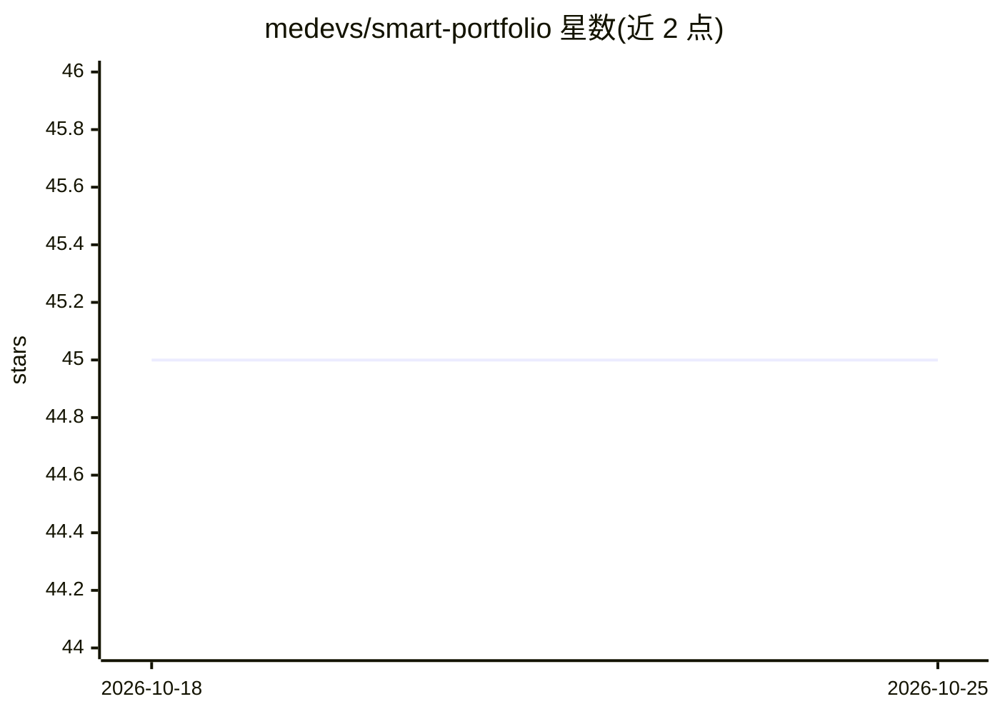

# medevs/smart-portfolio

⭐ 45 · TypeScript · MIT · 推送 2026-05-05 · [GitHub](https://github.com/medevs/smart-portfolio) · [官网](https://medevsmaker.vercel.app) · 个人维护

**带 AI 聊天机器人的终端风格个人作品集网站模板**

基于 Next.js 15 与 TypeScript 的个人作品集网站：终端风格 UI、bento 网格布局、明暗主题、Markdown 博客系统，所有内容（项目/技能/经历/教育）通过 TypeScript 配置文件管理。AI 功能为悬浮聊天组件，使用 LangChain 与 OpenAI 实现 RAG 问答，向量检索依托 Supabase pgvector（余弦相似度匹配）。需配置 Supabase 项目与 OpenAI API key，通过 npm 安装并运行迁移脚本后生成向量嵌入。

## 筛选速览

| 维度 | 判定 | 备注 |
|---|---|---|
| AI 角色 | `ai-enhanced` | 去掉 AI 部分产品仍成立 |
| 许可风险 | `permissive` | MIT |
| 部署形态 | `library` | 以包/库形式分发 |
| 模型依赖 | — | README 未给出锁定关系 |
| 硬件要求 | — | 无带数字的原话,不猜 |
| 安装摩擦 | `low` | 无编译、无系统依赖或容器化 |
| 成熟度 | — | 结构信号不足 |

## 能力要点

- RAG 聊天机器人：LangChain + OpenAI + Supabase pgvector 余弦相似度检索
- 终端风格 UI、bento 网格布局与明暗主题
- Markdown 博客系统（阅读时长估算、语法高亮、目录）
- 全部作品集内容由 src/config/ 下 TypeScript 配置文件管理

## 适用场景

- 搭建可由访客对话式浏览的个人作品集网站
- 展示项目、技能、经历并附带 AI 问答入口
- 开发者个人品牌站点与博客发布

## 场景标签

`聊天机器人` · 领域:对话与助手

## 证据(README 行号)

> L3: A modern, terminal-inspired portfolio website built with Next.js 15, featuring an AI-powered chatbot with RAG (Retri
> L7: - **AI-powered Chatbot**: Interactive portfolio exploration using LangChain and OpenAI, with vector search capabilit

## 星数曲线

2026-10-18 45 → 2026-10-25 45（+0）

---
*卡片 v1 · prompt 1.4 · 生成 2026-10-25 · 置信度 high · 依据 README sha `78bf8dd16592` · [字段定义](../../DATASET.md)*
