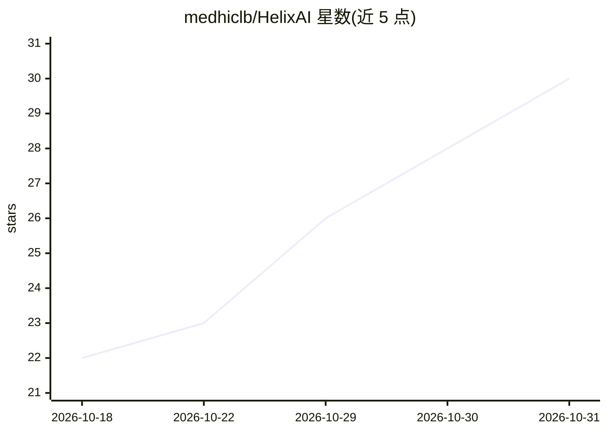

# medhiclb/HelixAI

⭐ 30 · TypeScript · AGPL-3.0 · 推送 2026-10-24 · [GitHub](https://github.com/medhiclb/HelixAI) · [官网](https://helix-agence.fr) · 个人维护 · 中文 README

**本地优先的开源 AI 工作台：聊天/Agent/编码/RAG/微调**

面向团队和组织的桌面应用（macOS/Windows/Linux），将本地模型聊天、知识库（RAG）、编码 Agent、定时任务 Agent、模型微调集成于一体。本地推理通过 LM Studio 引擎（Intel macOS 用 llama.cpp）运行，应用按机器内存自动安装适配的 Apache 2.0/MIT 开源模型；云端模型仅在用户自行填入 API key 时可用。提供 OpenAI 兼容实例 API、连接器审批门、团队账号与审计日志。AGPL-3.0，界面含中文等 7 种语言。

## 筛选速览

| 维度 | 判定 | 备注 |
|---|---|---|
| AI 角色 | `ai-native` | 本体是模型或模型工具 |
| 许可风险 | `viral` | AGPL-3.0 |
| 部署形态 | `desktop` | 安装包/桌面程序 |
| 模型依赖 | — | README 未给出锁定关系 |
| 硬件要求 | — | 无带数字的原话,不猜 |
| 安装摩擦 | `low` | 无编译、无系统依赖或容器化 |
| 成熟度 | — | 结构信号不足 |

## 能力要点

- 本地默认：通过 LM Studio 引擎运行模型，按机器内存自动选型
- 知识库 RAG、定时任务 Agent、基于 OpenCode 的编码 Agent
- 应用内微调小模型（Apple Silicon 用 MLX，NVIDIA 用 Unsloth）
- OpenAI 兼容实例 API 与团队功能（账号/2FA/审计日志/静态加密）

## 适用场景

- 在不联网或私有环境中为团队部署带知识库的 AI 聊天
- 让常驻 Agent 定时执行任务并在批准后操作系统与工具
- 用公司问答数据微调小模型并在聊天中使用

## 场景标签

`编码 Agent` `AI 助手` `RAG` `微调` · 领域:编码与开发

## 证据(README 行号)

> L5:  Your own AI workspace, on your own machines.
> L41: - **Local by default.** Models run on your machine or on your organisation's server, through
> L127: - **Chat** with local models **picked for each machine**: Helix AI installs the best-rated open

## 星数曲线

2026-10-18 22 → 2026-10-31 30（+8）

---
*卡片 v1 · prompt 1.4 · 生成 2026-10-27 · 置信度 high · 依据 README sha `4333d0d41460` · [字段定义](../../DATASET.md)*
