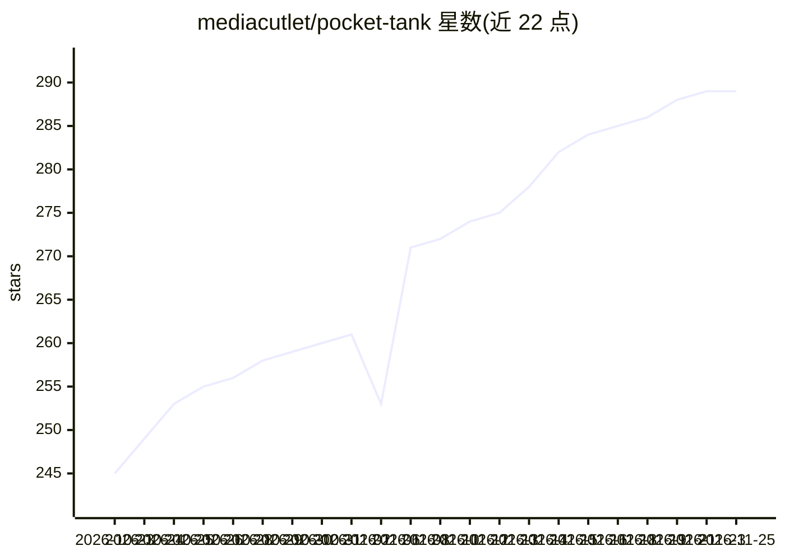

# mediacutlet/pocket-tank

⭐ 289 · C · NOASSERTION · 推送 2026-11-13 · [GitHub](https://github.com/mediacutlet/pocket-tank) · [官网](https://pocketank.com) · 个人维护

**14M 参数 LLM 在 ESP32-S3 上驱动虚拟鱼缸的每个决策**

完整项目包含蒸馏出的 14.3M 参数模型、蒸馏流水线、PC 模拟器与 ESP32-S3 固件。每条鱼把状态（饥饿、能量、恐惧、个性等）编码为一行文本，模型补全出目标与紧急度，反射层以 25-30 fps 转为运动；推理用 llama2.c 风格 4-bit 引擎跑在第二核，权重 7.56 MB 从 flash 内存映射读取，无网络无云端。支持四块 Waveshare 开发板，可浏览器安装固件，0.3 起支持 Wi-Fi 自更新。当前版本 v0.4.1（alpha）。

## 筛选速览

| 维度 | 判定 | 备注 |
|---|---|---|
| AI 角色 | `ai-enhanced` | 去掉 AI 部分产品仍成立 |
| 许可风险 | `none` | NOASSERTION |
| 部署形态 | `None` |  |
| 模型依赖 | — | README 未给出锁定关系 |
| 硬件要求 | — | 无带数字的原话,不猜 |
| 安装摩擦 | `low` | 无编译、无系统依赖或容器化 |
| 成熟度 | `idea` | |

## 能力要点

- 26B 教师模型蒸馏为 14.3M 学生模型，7.56 MB 4-bit 权重直接从 flash 运行
- llama2.c 风格 4-bit 推理引擎跑在 ESP32-S3 第二核，完全离线
- 三层架构：反射层、LLM 决策层、成长系统，无回退启发式覆盖模型决策
- 支持四款 Waveshare 板型（1.8 寸/吊坠/手表/方形）与 PC 模拟器

## 适用场景

- 在 8 美元级微控制器上体验离线 LLM 驱动的虚拟宠物
- 研究小模型端侧部署与知识蒸馏流水线
- 作为可随身佩戴的电子鱼缸宠物

## 场景标签

`推理引擎` `微调` · 领域:训练与推理

## 证据(README 行号)

> L6: A 14-million-parameter transformer, distilled from a 26-billion-parameter
> L9: explore, socialize, rest, or flee. No network. No cloud. The whole brain is a
> L78: - **LLM advisor** (`llm/`). A llama2.c-style 4-bit inference engine, a

## 星数曲线

2026-10-23 245 → 2026-11-25 289（+44）

---
*卡片 v1 · prompt 1.4 · 生成 2026-11-25 · 置信度 high · 依据 README sha `e4216ff898dc` · [字段定义](../../DATASET.md)*
