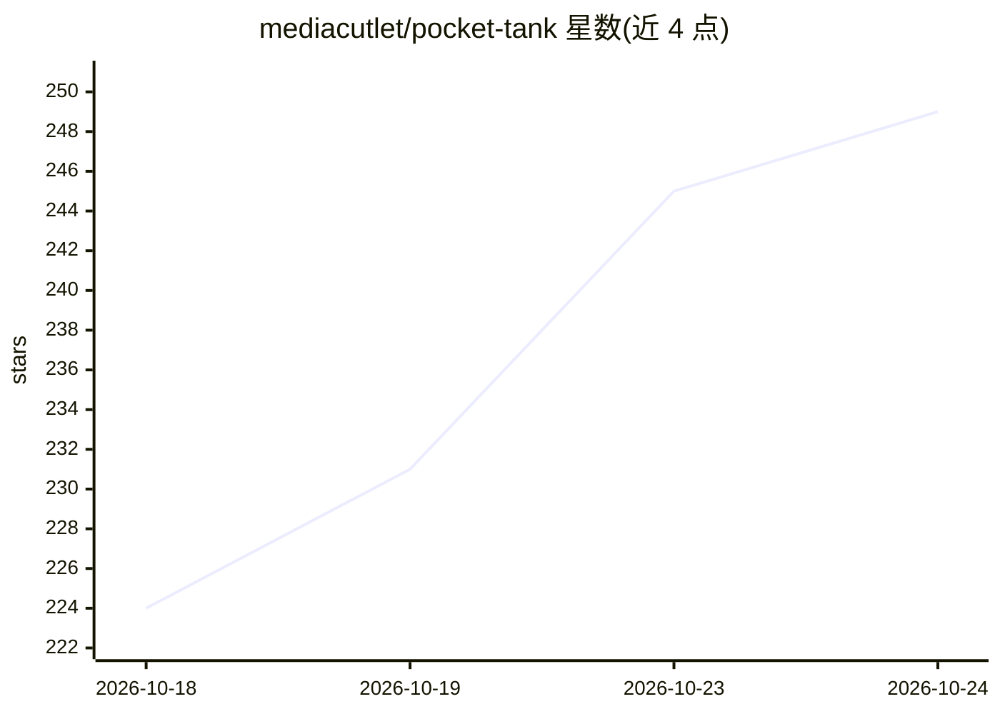

# mediacutlet/pocket-tank

⭐ 253 · C · MIT · 推送 2026-10-21 · [GitHub](https://github.com/mediacutlet/pocket-tank) · [官网](https://pocketank.com) · 个人维护

**在 ESP32-S3 上用 14M 参数微型 LLM 驱动的虚拟水族箱固件**

面向硬件爱好者的虚拟养鱼水族箱项目：一块 14.3M 参数、4-bit 量化后 7.56 MB 的 llama2.c 风格 transformer，从 26B 教师模型蒸馏而来，完全离线运行在 ESP32-S3 单片机的一个核心上，为最多 4-6 条虚拟鱼做出吃食、探索、休息等高层决策；另一核心以 25-30 fps 渲染画面。词表为 54 token 的封闭 schema，决策耗时约 3.7 秒。仓库含模型、蒸馏管线、PC 模拟器和板子固件，支持四款 Waveshare 板，可通过浏览器安装，Wi-Fi 自更新；当前版本 v0.3.8.1 处于 alpha 阶段。

## 筛选速览

| 维度 | 判定 | 备注 |
|---|---|---|
| AI 角色 | `ai-native` | 本体是模型或模型工具 |
| 许可风险 | `permissive` | MIT |
| 部署形态 | `None` |  |
| 模型依赖 | — | README 未给出锁定关系 |
| 硬件要求 | — | 无带数字的原话,不猜 |
| 安装摩擦 | `low` | 无编译、无系统依赖或容器化 |
| 成熟度 | `idea` | |

## 能力要点

- 14.3M 参数模型 4-bit 量化至 7.56 MB，从 26B 教师蒸馏，离线运行于 ESP32-S3
- 模型与物理反射层分核运行：决策约 3.7 秒/次，渲染 25-30 fps
- 54 token 封闭 schema 词表，51,613 条教师标注情境训练
- 仓库包含模型、蒸馏管线、PC 模拟器与板子固件，支持浏览器安装与 Wi-Fi 自更新

## 适用场景

- 在几十美元的 ESP32-S3 开发板上养一个由 LLM 决策驱动的虚拟鱼缸
- 在 PC 模拟器中体验同一套鱼缸逻辑
- 研究小模型蒸馏与嵌入式设备上的 LLM 推理

## 场景标签

`微调` · 领域:训练与推理

## 证据(README 行号)

> L6: A 14-million-parameter transformer, distilled from a 26-billion-parameter
> L15: The fish aren't scripted. Each one periodically describes its situation to the
> L78: - **LLM advisor** (`llm/`). A llama2.c-style 4-bit inference engine, a

## 星数曲线

2026-10-18 224 → 2026-10-24 249（+25）

---
*卡片 v1 · prompt 1.4 · 生成 2026-10-22 · 置信度 high · 依据 README sha `33dca92af443` · [字段定义](../../DATASET.md)*
