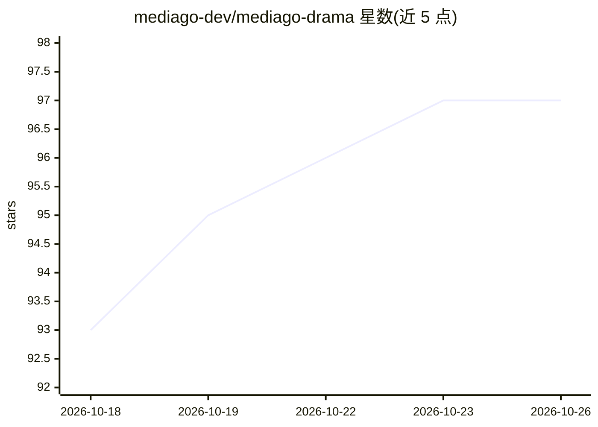

# mediago-dev/mediago-drama

⭐ 97 · Go · Apache-2.0 · 推送 2026-10-21 · [GitHub](https://github.com/mediago-dev/mediago-drama) · [官网](https://mediago.torchstellar.com/) · 组织维护 · 中文 README

**面向漫剧创作的本地 Agent 工作台：小说改短剧全流程**

以文档驱动方式组织小说到短剧的创作流程：原文导入、剧情解析、剧本改写、角色/场景/道具设定、分镜拆解到图片与视频生成，均以本地 Markdown 等文件保存为项目事实来源，供人工编辑与 Agent 共同使用。Agent 基于 Codex app-server，通过 Skill 文件（8 个内置 Skill）执行剧本、角色、分镜等任务；模型路由统一管理图片、视频与文本生成渠道。技术栈为 Go 服务端 + React/Electron 前端，通过 One CLI 管理。开源版不含商业组件，需登录 ChatGPT 或配置 Codex 中转。

## 筛选速览

| 维度 | 判定 | 备注 |
|---|---|---|
| AI 角色 | `ai-native` | 本体是模型或模型工具 |
| 许可风险 | `permissive` | Apache-2.0 |
| 部署形态 | `None` |  |
| 模型依赖 | — | README 未给出锁定关系 |
| 硬件要求 | — | 无带数字的原话,不猜 |
| 安装摩擦 | `low` | 无编译、无系统依赖或容器化 |
| 成熟度 | `idea` | |

## 能力要点

- 文档驱动：原文/剧本/角色/场景/道具/分镜构成项目事实来源，可读可改
- Agent 工作台基于原生 Codex 0.163.0 app-server，支持流式对话与工具调用
- 8 个内置 Skill 覆盖剧本、角色、场景、道具、分镜、图片与视频生成
- 统一模型路由，按生成效果、成本和可用性选择执行渠道

## 适用场景

- 把小说改编为短剧并逐阶段生成角色图、场景图与分镜视频
- 在可编辑文档中管理漫剧项目的设定并跨章节复用
- 沉淀自己的写作规则、画风与提示词模板供后续项目使用

## 场景标签

`图像生成` `视频生成` `AI 写作` · 领域:内容生成

## 证据(README 行号)

> L19: MediaGo Drama 是一个面向漫剧生产的本地 Agent 工作台。它把原文、剧本、角色、场景、道具、分镜和生成素材组织成一个持续演进的创作项目，让 Agent 可以在同一份项目上下文中完成分析、改写、整理和生成任务。
> L21: 产品围绕“原文 → 剧本 → 设定 → 分镜 → 素材 → 视频”的流程构建。创作者可以在任意阶段查看和编辑文档，也可以继续让 Agent 读取已有内容并推进后续工作。
> L108: - 围绕项目中的角色、场景、道具和分镜生成图片与视频。

## 星数曲线

2026-10-18 93 → 2026-10-26 97（+4）

---
*卡片 v1 · prompt 1.4 · 生成 2026-10-23 · 置信度 high · 依据 README sha `2125ee765f3a` · [字段定义](../../DATASET.md)*
