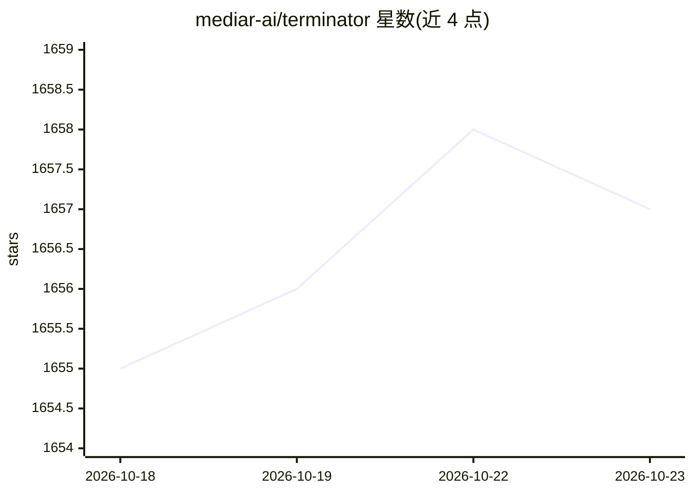

# mediar-ai/terminator

⭐ 1,657 · Rust · MIT · 推送 2026-06-02 · [GitHub](https://github.com/mediar-ai/terminator) · [官网](https://t8r.tech/) · 组织维护

**让 AI 助手通过 MCP 控制整个 Windows 桌面的自动化框架**

面向 AI 助手（Claude、Cursor、VS Code 等）的 Computer Use MCP 与桌面自动化库：通过像素、DOM 与 Accessibility tree 三层定位控制 Windows 应用，支持元素定位、UI 操作、浏览器自动化（Chrome 扩展）、工作流录制与截图等。机制上以确定性代码预训练工作流，仅在需要恢复时调用 AI；以 MCP agent（npx）、npm/cargo/pip 库等多种形式分发。当前仅支持 Windows，macOS 与 Linux 不可用；Python 库为部分/实验性支持。另有公测的工作流构建器与托管托管服务。

## 筛选速览

| 维度 | 判定 | 备注 |
|---|---|---|
| AI 角色 | `ai-ecosystem` | LLM/agent 周边工具 |
| 许可风险 | `permissive` | MIT |
| 部署形态 | `desktop` | 安装包/桌面程序 |
| 模型依赖 | — | README 未给出锁定关系 |
| 硬件要求 | — | 无带数字的原话,不猜 |
| 安装摩擦 | `low` | 无编译、无系统依赖或容器化 |
| 成熟度 | `idea` | |

## 能力要点

- 像素、DOM、Accessibility tree 三层元素定位与操作
- 工作流录制并转为确定性自动化，AI 仅用于恢复
- 提供 Python/TypeScript/Rust 库、CLI 与 MCP agent 多种分发形式
- 使用现有浏览器会话，无需重新登录

## 适用场景

- 让 Claude/Cursor/VS Code 等 MCP 客户端控制 Windows 桌面执行任务
- 跨桌面应用与浏览器编写自动化脚本
- 录制人工操作流程生成确定性自动化工作流

## 场景标签

`GUI 自动化` `浏览器自动化` · 领域:效率与自动化

## 证据(README 行号)

> L37: ## Computer Use MCP that controls your entire desktop
> L39: Give AI assistants (Claude, Cursor, VS Code, etc.) the ability to control your desktop and automate tasks across an
> L113: |MCP (`terminator-mcp-agent`)|Yes|No|No|`npx -y terminator-mcp-agent --add-to-app [app]`|

## 星数曲线

2026-10-18 1,655 → 2026-10-23 1,657（+2）

---
*卡片 v1 · prompt 1.4 · 生成 2026-10-21 · 置信度 high · 依据 README sha `98e6f4ae7e6e` · [字段定义](../../DATASET.md)*
