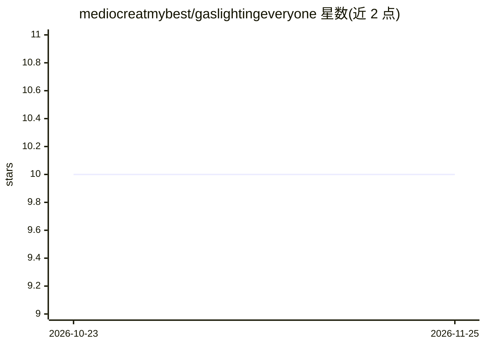

# mediocreatmybest/gaslightingeveryone

⭐ 10 · Python · MIT · 推送 2026-11-18 · [GitHub](https://github.com/mediocreatmybest/gaslightingeveryone) · 个人维护

**为 Stable Diffusion 整理图像标注与批量图像处理的脚本集**

个人脚本仓库，包含三部分：caption 创建工具，读取 gallery-dl 等程序输出的 json 元数据或批量编辑文本文件，为 Stable Diffusion 类程序生成标注；图像处理脚本，对文件夹内图像调整尺寸或宽高比并保留原始母本副本；以及杂项脚本，如 Linux/Windows 下批量 git pull 的工具。作者自述脚本质量不高，接受 PR 与 issue。

## 筛选速览

| 维度 | 判定 | 备注 |
|---|---|---|
| AI 角色 | `ai-enhanced` | 去掉 AI 部分产品仍成立 |
| 许可风险 | `permissive` | MIT |
| 部署形态 | `None` |  |
| 模型依赖 | — | README 未给出锁定关系 |
| 硬件要求 | — | 无带数字的原话,不猜 |
| 安装摩擦 | `low` | 无编译、无系统依赖或容器化 |
| 成熟度 | — | 结构信号不足 |

## 能力要点

- caption 工具利用 gallery-dl --write-metadata 的 json 元数据批量生成标注
- 图像尺寸/宽高比批量调整，保留带标注的原始母本文件夹
- 提供 Linux 与 Windows 的批量 git pull 脚本

## 适用场景

- 为 Stable Diffusion 训练数据批量生成图像标注
- 批量调整图像尺寸同时保留原始文件与标注
- 批量更新多个 git 仓库

## 场景标签

`图像视频处理` · 领域:感知与多模态

## 证据(README 行号)

> L3: This repository contains strong traces of gaslighting, along with a few files for; machine learning, containers, and
> L10: These scripts/tools have been made to assist in the creation of captions for programs such as stable diffusion and 

## 星数曲线

2026-10-23 10 → 2026-11-25 10（+0）

---
*卡片 v1 · prompt 1.4 · 生成 2026-11-19 · 置信度 mid · 依据 README sha `65d16b0f6a3f` · [字段定义](../../DATASET.md)*
