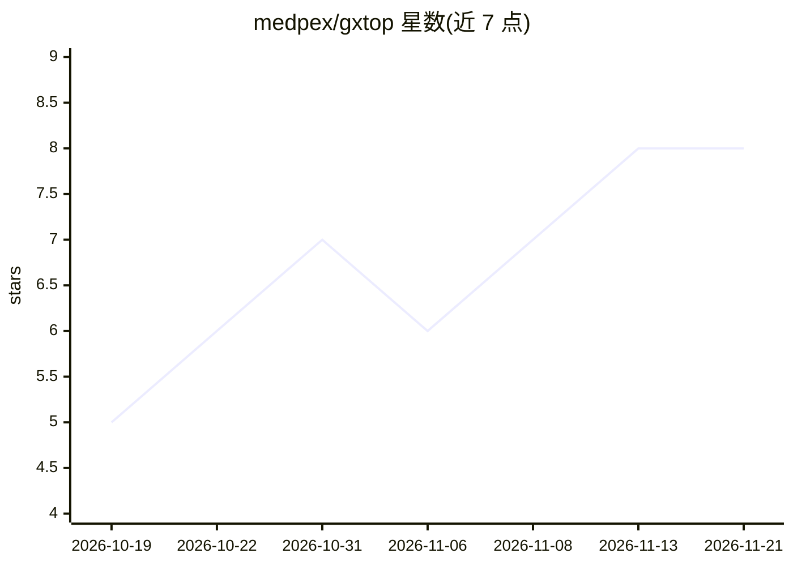

# medpex/gxtop

⭐ 8 · Python · MIT · 推送 2026-10-09 · [GitHub](https://github.com/medpex/gxtop) · 个人维护

**GB10 机器的数字雨风格 GPU/内存/已加载模型监视器**

单文件 Python TUI（仅依赖标准库与 curses），面向 NVIDIA GB10 桌面（ASUS Ascent GX10、DGX Spark 等），显示 GPU 利用率、统一内存按引擎拆分、CPU、系统温度与进程列表。核心机制是本地进程与 HTTP 端点探测：识别 vLLM、Ollama、ComfyUI、llama.cpp、SGLang、TGI、TensorRT-LLM 已加载的模型及其 Docker 容器/systemd 来源，并以数字雨动画随 GPU 负载变化。提供 --json 单次采样输出；通用部分也可在其他 NVIDIA 系统运行。

## 筛选速览

| 维度 | 判定 | 备注 |
|---|---|---|
| AI 角色 | `ai-enhanced` | 去掉 AI 部分产品仍成立 |
| 许可风险 | `permissive` | MIT |
| 部署形态 | `None` |  |
| 模型依赖 | local-ok | 支持本地模型 |
| 硬件要求 | — | 无带数字的原话,不猜 |
| 安装摩擦 | `low` | 无编译、无系统依赖或容器化 |
| 成熟度 | — | 结构信号不足 |

## 能力要点

- 单 Python 文件、零第三方依赖，仅用标准库与 curses
- GB10 上 nvidia-smi 不支持显存汇报时，按进程累加并按引擎拆分统一内存
- 检测 7 类推理引擎的已加载模型、端口、PID 与实时指标
- --json 单次采样输出，便于脚本调用

## 适用场景

- 在 GX10/DGX Spark 上查看当前哪些 AI 模型被哪个引擎加载
- 按引擎监控统一内存占用与 KV-cache 使用情况
- 观察模型加载/卸载、生成吞吐与 OOM 事件的实时日志
- 用 --json 输出做脚本化检测与调试

## 场景标签

 · 领域:系统监控/运维工具

## 证据(README 行号)

> L11: - **Single Python file, zero dependencies.** It only uses the standard library and `curses`.
> L70: - Linux with an NVIDIA GPU and `nvidia-smi`. gxtop is built for GB10, but the generic parts also run on other NVIDI

## 星数曲线

2026-10-19 5 → 2026-11-21 8（+3）

---
*卡片 v1 · prompt 1.4 · 生成 2026-11-20 · 置信度 high · 依据 README sha `1c2e3fce3aac` · [字段定义](../../DATASET.md)*
