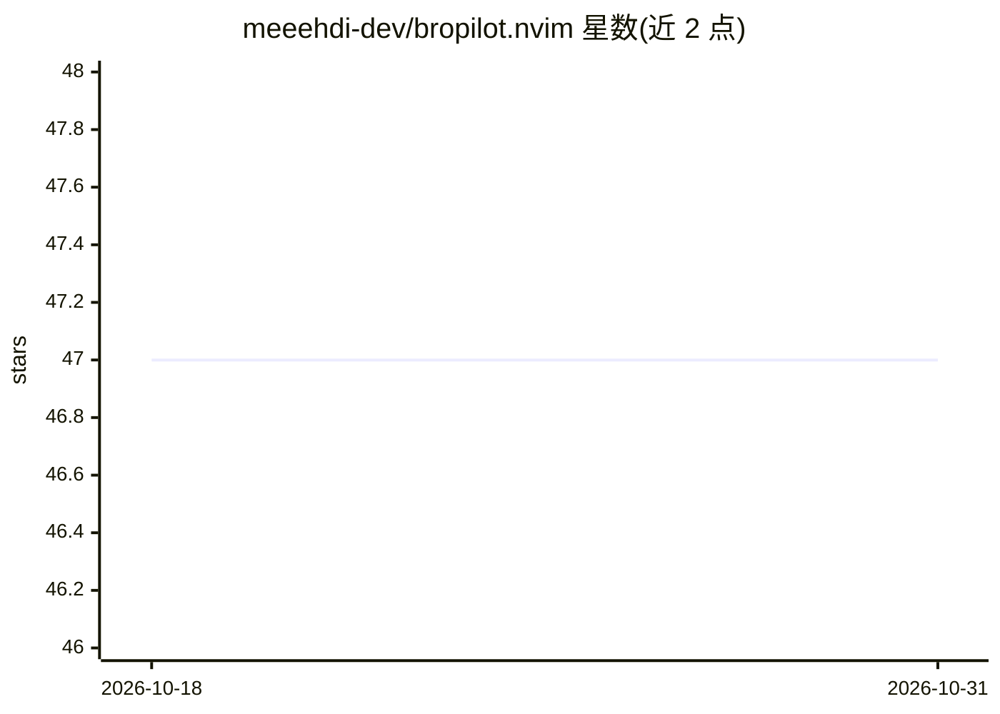

# meeehdi-dev/bropilot.nvim

⭐ 47 · Lua · MIT · 推送 2026-07-04 · [GitHub](https://github.com/meeehdi-dev/bropilot.nvim) · 个人维护

**Neovim 本地代码补全插件：经 Ollama 使用本地 LLM 生成建议**

面向 Neovim 用户的代码建议与补全插件，定位为 GitHub Copilot 的本地化替代：通过 Ollama API 运行本地 FIM 兼容模型（qwen2.5-coder、deepseek-coder、starcoder2、codellama 等），也支持 Codestral/Mistral/DeepSeek/Gemini 在线 API。后台下载并运行 llm-language-server 跟踪编辑中文件状态并与所选 LLM 通信。提供防抖自动建议、文件类型排除与可配置快捷键；本地模式需先安装并运行 Ollama。

## 筛选速览

| 维度 | 判定 | 备注 |
|---|---|---|
| AI 角色 | `ai-native` | 本体是模型或模型工具 |
| 许可风险 | `permissive` | MIT |
| 部署形态 | `None` |  |
| 模型依赖 | local-ok | 支持本地模型 |
| 硬件要求 | — | 无带数字的原话,不猜 |
| 安装摩擦 | `low` | 无编译、无系统依赖或容器化 |
| 成熟度 | — | 结构信号不足 |

## 能力要点

- 通过 Ollama API 使用本地 FIM 兼容模型（含已测试模型列表）
- 支持 Codestral/Mistral/DeepSeek/Gemini 在线 provider
- 后台运行 llm-language-server 跟踪文件编辑状态
- 自动防抖建议、排除文件类型与自定义快捷键

## 适用场景

- 在 Neovim 中获得本地运行的代码补全，不依赖云端服务
- 切换多个在线/本地 provider 获取代码建议
- 为 FIM 兼容的本地模型配置逐行补全

## 场景标签

`代码生成` · 领域:编码与开发

## 证据(README 行号)

> L3: Bropilot is a GitHub Copilot alternative that can handle multiple providers, with the main advantage of being able t
> L5: In the background, this plugin downloads and runs llm-language-server, a language server used to keep track of the c

## 星数曲线

2026-10-18 47 → 2026-10-31 47（+0）

---
*卡片 v1 · prompt 1.4 · 生成 2026-10-25 · 置信度 high · 依据 README sha `0328e3a99961` · [字段定义](../../DATASET.md)*
