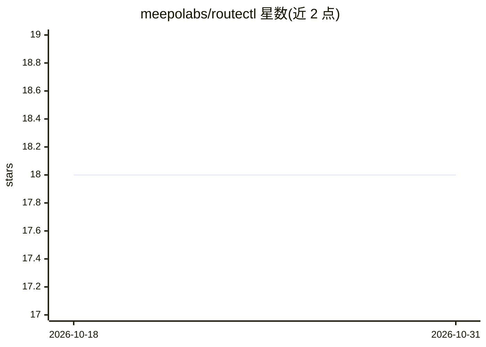

# meepolabs/routectl

⭐ 18 · Rust · MIT · 推送 2026-10-30 · [GitHub](https://github.com/meepolabs/routectl) · 组织维护

**本地 LLM 路由器：统一 OpenAI/Anthropic 端点，跨供应商故障转移**

单个 Rust 二进制，监听 127.0.0.1，同时讲 OpenAI 与 Anthropic API 方言：三种入口方言归一为规范请求，路由器应用重试/能力过滤/缓存策略，再由五类出口供应商（openai-compat、anthropic-api、bedrock、openai-responses、gemini）翻译转发。别名映射到跨供应商回退链，失败按类别（rate-limited/auth 等）分类处理，带熔断与按供应商限速。能力注册表从实际拒绝中学习并跨重启持久化。凭据只存引用（env/file/oauth），默认绑定回环地址。内置 SQLite 用量台账与只读仪表盘。非目标：多用户认证、TLS 终止、缓存层。面向使用多家 LLM 供应商的开发者。

## 筛选速览

| 维度 | 判定 | 备注 |
|---|---|---|
| AI 角色 | `ai-ecosystem` | LLM/agent 周边工具 |
| 许可风险 | `permissive` | MIT |
| 部署形态 | `desktop` | 安装包/桌面程序 |
| 模型依赖 | local-ok | 支持本地模型 |
| 硬件要求 | — | 无带数字的原话,不猜 |
| 安装摩擦 | `medium` | 含编译或系统依赖之一 |
| 成熟度 | — | 结构信号不足 |

## 能力要点

- 别名→跨供应商回退链，按失败类别配置重试与回退策略
- N+M 架构：三种入口方言×五类出口供应商翻译
- 能力注册表从实际拒绝中学习并跨重启持久化
- 凭据仅存引用（env:///file:///oauth://），拒绝明文
- SQLite 用量台账、只读仪表盘与 routectl usage 成本汇总

## 适用场景

- 让 Claude Code / codex 等客户端不改动代码即接入多供应商
- 单一配置文件管理多家供应商的密钥与模型别名
- 请求失败时自动跨供应商回退并追踪成本
- 作为 Anthropic 网关模式的本地实现运行 Claude Code

## 场景标签

`模型网关` · 领域:Agent 开发

## 证据(README 行号)

> L5: routectl is a single Rust binary that runs on `127.0.0.1` and speaks
> L121: 3. One of five egress provider classes translates back out to the
> L124: N+M translators instead of NxM -- a new ingress dialect or egress

## 星数曲线

2026-10-18 18 → 2026-10-31 18（+0）

---
*卡片 v1 · prompt 1.4 · 生成 2026-10-29 · 置信度 high · 依据 README sha `ebc7f17b8dfb` · [字段定义](../../DATASET.md)*
