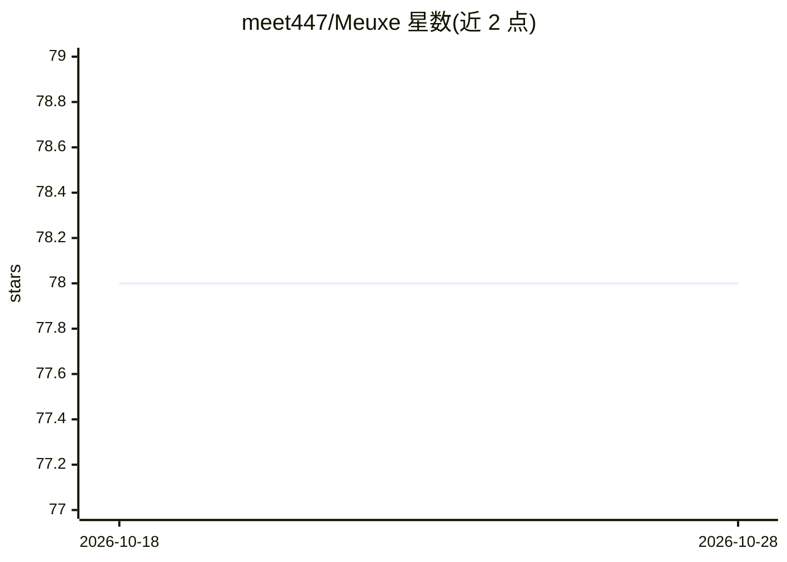

# meet447/Meuxe

⭐ 78 · TypeScript · MIT · 推送 2026-10-08 · [GitHub](https://github.com/meet447/Meuxe) · [官网](https://meet447.github.io/Meuxe/) · 个人维护

**桌面 AI 陪伴角色：本地记忆、语音对话的 Live2D/VRM 伴侣**

基于 Tauri 2 的桌面 AI 陪伴应用：屏幕上的 Live2D/VRM 角色可对话、语音朗读（默认免费 TTS，可切 ElevenLabs/OpenAI）、可选端上 Whisper 语音输入，并持久化记忆、人设、心情与关系状态（全部本地存储）。聊天通过 Agent Client Protocol 连接用户自装的 CLI agent（Claude Code、Codex、OpenCode 或任意 ACP agent），Meuxe 本身不内置模型。提供 macOS Apple Silicon 与 Linux 预构建包，处于早期开发阶段，配置/API 可能破坏性变更。

## 筛选速览

| 维度 | 判定 | 备注 |
|---|---|---|
| AI 角色 | `ai-native` | 本体是模型或模型工具 |
| 许可风险 | `permissive` | MIT |
| 部署形态 | `desktop` | 安装包/桌面程序 |
| 模型依赖 | — | README 未给出锁定关系 |
| 硬件要求 | — | 无带数字的原话,不猜 |
| 安装摩擦 | `medium` | 含编译或系统依赖之一 |
| 成熟度 | `idea` | |

## 能力要点

- 记忆、人设、心情与关系状态全部本地存储
- Live2D/VRM 角色，唇形同步与表情标签解析
- 作为 ACP 客户端连接用户自选的 CLI agent，不绑定模型 API
- 端上 Whisper 语音转写（一次性下载约 75MB 模型），角色以 .yaml/.md 文件定义

## 适用场景

- 在桌面常驻一个能记住自己的 AI 陪伴角色
- 带语音输入输出与角色表情的沉浸式对话
- 本地优先、数据不出机器的隐私陪伴场景

## 场景标签

`聊天机器人` · 领域:对话与助手

## 证据(README 行号)

> L20: Meuxe is a character on your screen who remembers past conversations, speaks with a voice, and reacts with expressi
> L24: - **Remembers you.** Your companion writes down what matters as you talk: facts about you, moments you shared, and 
> L27: - **Voice in and out.** Your companion speaks aloud with live captions, and listens through your microphone with op

## 星数曲线

2026-10-18 78 → 2026-10-28 78（+0）

---
*卡片 v1 · prompt 1.4 · 生成 2026-10-24 · 置信度 mid · 依据 README sha `c760348e8326` · [字段定义](../../DATASET.md)*
