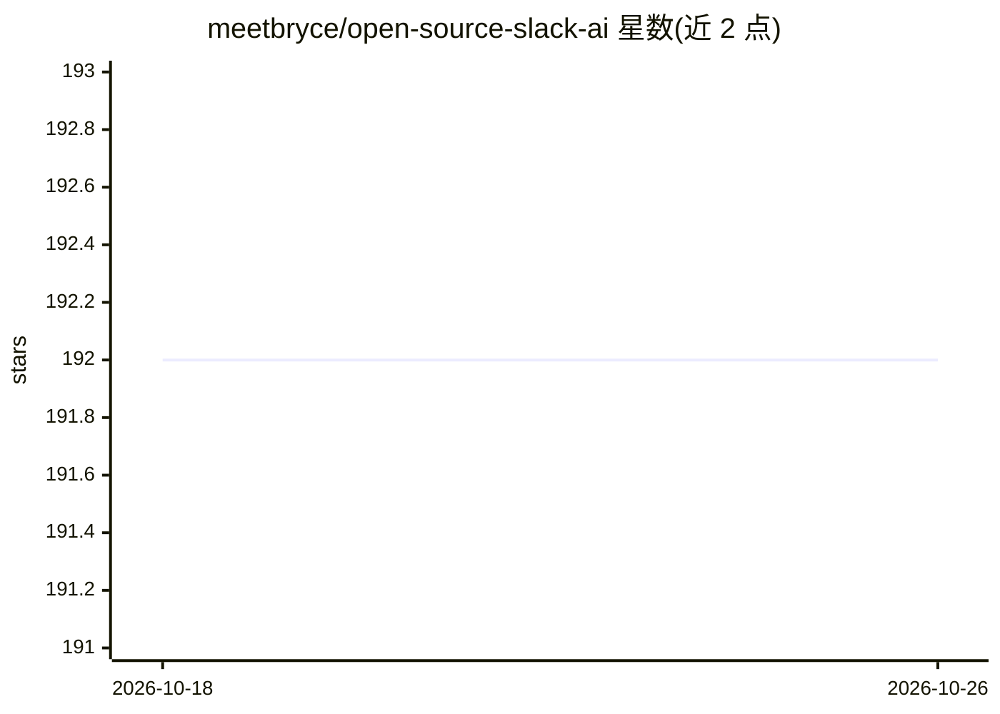

# meetbryce/open-source-slack-ai

⭐ 192 · Python · GPL-3.0 · 推送 2026-10-23 · [GitHub](https://github.com/meetbryce/open-source-slack-ai) · [官网](https://opensourceslackai.com) · 个人维护

**自托管 Slack AI 替代：按需生成频道与线程摘要**

可自行托管的 Slack 应用，通过斜杠命令生成线程摘要、频道概述、指定时间以来的频道摘要与完整频道摘要（实验性），默认使用 OpenAI GPT-4.1，频道概述由 NLP 模型集成加 GPT-4.1 解释生成；支持自定义提示词。面向希望替代 Slack AI 付费附加功能的 Slack 工作区，需自备 OpenAI API key 与 Slack 应用令牌，以 Poetry + FastAPI 服务器方式运行并经 ngrok 暴露，GPL-3.0 许可。对其他开源 LLM 的支持列为未来计划。

## 筛选速览

| 维度 | 判定 | 备注 |
|---|---|---|
| AI 角色 | `ai-native` | 本体是模型或模型工具 |
| 许可风险 | `viral` | GPL-3.0 |
| 部署形态 | `None` |  |
| 模型依赖 | — | README 未给出锁定关系 |
| 硬件要求 | — | 无带数字的原话,不猜 |
| 安装摩擦 | `low` | 无编译、无系统依赖或容器化 |
| 成熟度 | — | 结构信号不足 |

## 能力要点

- 四类摘要命令：线程/频道概述/自某时起/完整频道（实验性）
- 默认 GPT-4.1，频道概述用 NLP 模型集成加 GPT-4.1
- 支持自定义提示词（如匿名化摘要）
- 基于 LangChain/LangSmith，含单元与集成测试

## 适用场景

- 团队按需总结 Slack 频道和线程内容
- 不购买 Slack AI 附加订阅而自托管摘要功能
- 自定义摘要提示词（如匿名化输出）

## 场景标签

`AI 写作` · 领域:内容生成

## 证据(README 行号)

> L6: This repository is a ready-to-run basic Slack AI solution you can host yourself and unlock the ability to summarize
> L15: 1. **Thread summaries** - Generate a detailed summary of any Slack thread (powered by GPT-4.1 by default)

## 星数曲线

2026-10-18 192 → 2026-10-26 192（+0）

---
*卡片 v1 · prompt 1.4 · 生成 2026-10-22 · 置信度 high · 依据 README sha `3afabbd4935f` · [字段定义](../../DATASET.md)*
