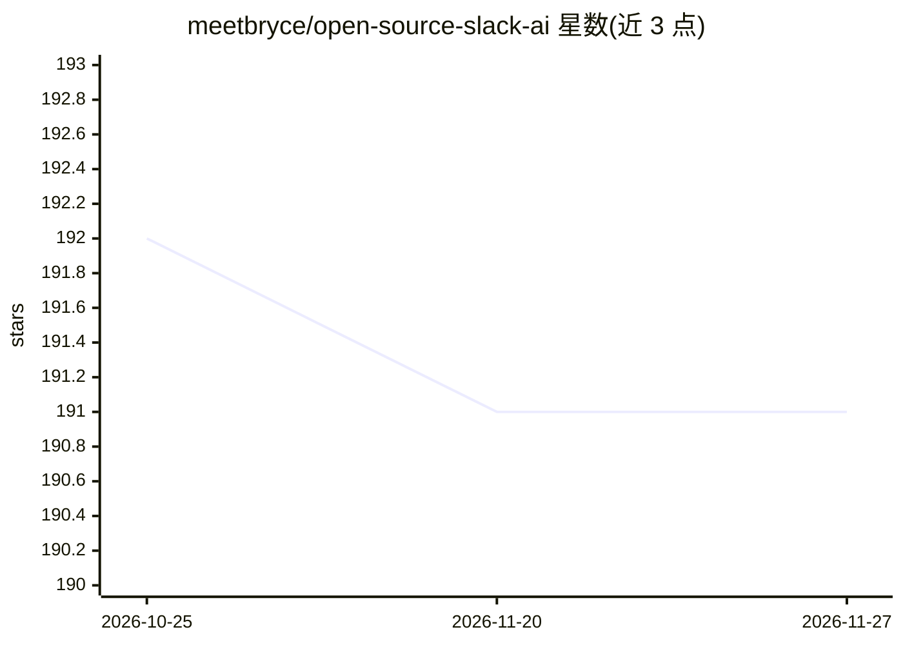

# meetbryce/open-source-slack-ai

⭐ 191 · Python · GPL-3.0 · 推送 2026-11-19 · [GitHub](https://github.com/meetbryce/open-source-slack-ai) · [官网](https://opensourceslackai.com) · 个人维护

**自托管 Slack 机器人：随时生成频道与线程摘要**

可自托管的 Slack AI 应用，替代 Slack AI 部分付费功能：为公共和私有频道提供线程摘要、频道主题概览、指定时间点后的频道摘要及全量频道历史摘要（实验性），支持自定义提示词。默认通过 OpenAI 模型驱动，频道概览另结合 NLP 模型做主题分析。技术上基于 Python 3.9–3.11 与 Poetry 管理，使用 FastAPI 提供服务，经 ngrok 暴露给 Slack；已迁移至 LangChain 与 LangSmith 做扩展与追踪。限制：目前仅支持 OpenAI，替代/开源 LLM 支持尚在计划中。

## 筛选速览

| 维度 | 判定 | 备注 |
|---|---|---|
| AI 角色 | `ai-native` | 本体是模型或模型工具 |
| 许可风险 | `viral` | GPL-3.0 |
| 部署形态 | `None` |  |
| 模型依赖 | — | README 未给出锁定关系 |
| 硬件要求 | — | 无带数字的原话,不猜 |
| 安装摩擦 | `low` | 无编译、无系统依赖或容器化 |
| 成熟度 | — | 结构信号不足 |

## 能力要点

- 四类摘要功能：线程摘要、频道概览、时间点摘要、全量历史摘要
- 支持自定义提示词（如匿名化摘要指令）
- 已集成 LangChain 与 LangSmith 的可观测性与用户反馈采集
- 提供单元测试与真实 OpenAI 调用的集成测试套件

## 适用场景

- 团队在 Slack 中按需获取长线程的快速摘要
- 了解某个频道的用途与讨论主题概览
- 替代付费的 Slack AI 摘要功能并自行托管

## 场景标签

 · 领域:团队协作/LLM 应用

## 证据(README 行号)

> L6: This repository is a ready-to-run basic Slack AI solution you can host yourself and unlock the ability to summarize
> L15: 1. **Thread summaries** - Generate a detailed summary of any Slack thread (powered by GPT-6 Luna by default)

## 星数曲线

2026-10-25 192 → 2026-11-27 191（-1）

---
*卡片 v1 · prompt 1.4 · 生成 2026-11-26 · 置信度 high · 依据 README sha `253ca69eea7b` · [字段定义](../../DATASET.md)*
