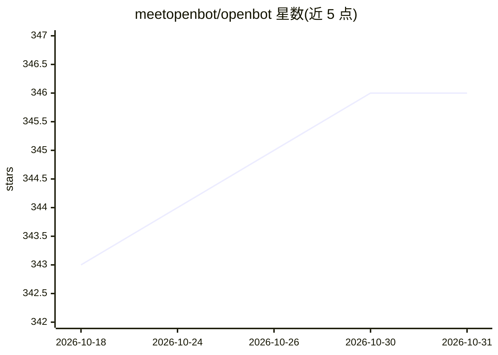

# meetopenbot/openbot

⭐ 346 · TypeScript · MIT · 推送 2026-07-07 · [GitHub](https://github.com/meetopenbot/openbot) · [官网](https://www.getopenbot.com/) · 个人维护

**本地优先的 AI agent 运行环境，含事件 API 与本地存储**

OpenBot 是一个 local-first 的 AI agent 运行 harness：在本地启动 agent 服务器（默认端口 4132），将 channels、threads、agents、plugins 与配置存储于 ~/.openbot 目录。内置基于 LLM 的 system agent（含存储工具）与无 LLM 的确定性 state agent，支持从 AGENT.md 加载自定义 agent、通过 Server-Sent Events 流式推送事件，并提供 REST API（events/publish/state）。内置 openbot、storage、ui 三个插件，运行时由 Melony 提供支持。需 Node.js >=20.12.0，通过 npm 全局安装，使用 LLM 需设置 API key（如 OPENAI_API_KEY）。README 末尾说明 MIT 许可仅适用至 v0.5.3 归档版本，更新代码不在本仓库发布。

## 筛选速览

| 维度 | 判定 | 备注 |
|---|---|---|
| AI 角色 | `ai-ecosystem` | LLM/agent 周边工具 |
| 许可风险 | `permissive` | MIT |
| 部署形态 | `library` | 以包/库形式分发 |
| 模型依赖 | — | README 未给出锁定关系 |
| 硬件要求 | — | 无带数字的原话,不猜 |
| 安装摩擦 | `low` | 无编译、无系统依赖或容器化 |
| 成熟度 | — | 结构信号不足 |

## 能力要点

- 本地事件 API 与 SSE 流式事件推送
- 内置 LLM system agent 与无 LLM 的确定性 state agent
- 通过 ~/.openbot/agents/<agent-id>/AGENT.md 加载自定义 agent
- channels/threads/agents/plugins/config 本地存储于 ~/.openbot

## 适用场景

- 在本地运行和管理 AI agent 并通过 API 调用
- 以自定义 AGENT.md 定义自己的 assistant agent
- 需要数据本地存储的个人 AI 助手场景

## 场景标签

`AI 助手` `Agent 框架` · 领域:Agent 开发

## 证据(README 行号)

> L8: OpenBot is a local-first harness for running AI agents. It exposes a small event API, local file storage, and a Melo
> L14: - Ships with a built-in `system` agent (LLM runtime + storage tools).

## 星数曲线

2026-10-18 343 → 2026-10-31 346（+3）

---
*卡片 v1 · prompt 1.4 · 生成 2026-10-21 · 置信度 high · 依据 README sha `3065fd9dd249` · [字段定义](../../DATASET.md)*
