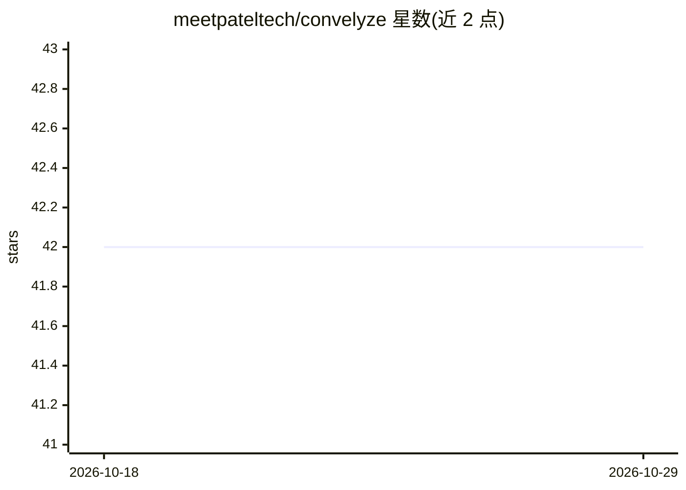

# meetpateltech/convelyze

⭐ 42 · TypeScript · 推送 2026-09-06 · [GitHub](https://github.com/meetpateltech/convelyze) · [官网](https://convelyze.pages.dev) · 个人维护

**可视化 ChatGPT 使用数据的网页分析工具**

基于 React/Next.js 的 Web 应用：用户从 chatgpt.com 导出数据包，上传其中的 conversations.json，即可在仪表盘查看对话数、消息数、GPT 与模型用量、语音消息、生成图像、Canvas/工具使用统计等指标，并提供月度模型用量分解与费用估算、活动日历与时间线图表。数据全部在客户端处理，不经服务器。本地运行需用 Bun 安装依赖并启动开发服务器，另提供 Docker Compose 方式部署。

## 筛选速览

| 维度 | 判定 | 备注 |
|---|---|---|
| AI 角色 | `ai-enhanced` | 去掉 AI 部分产品仍成立 |
| 许可风险 | `none` | — |
| 部署形态 | `self-host` | docker 或自建部署 |
| 模型依赖 | — | README 未给出锁定关系 |
| 硬件要求 | — | 无带数字的原话,不猜 |
| 安装摩擦 | `low` | 无编译、无系统依赖或容器化 |
| 成熟度 | — | 结构信号不足 |

## 能力要点

- 读取 ChatGPT 导出的 conversations.json 生成多维度使用统计
- 月度模型用量分解与费用估算、API 价格对比
- 全部数据处理在客户端完成，对话内容不上传
- 活动日历、使用时间线与多种交互图表

## 适用场景

- 我想查看自己使用 ChatGPT 的频率、模型偏好与时间分布
- 估算自己 ChatGPT 用量对应的费用并与 API 价格对比
- 在本地隐私安全地分析 ChatGPT 对话导出数据

## 场景标签

`数据分析` · 领域:效率与自动化

## 证据(README 行号)

> L3: Convelyze is a powerful web application that visualizes your ChatGPT usage, providing comprehensive analytics and in
> L58: 3. **Upload and Analyze**:

## 星数曲线

2026-10-18 42 → 2026-10-29 42（+0）

---
*卡片 v1 · prompt 1.4 · 生成 2026-10-25 · 置信度 high · 依据 README sha `e6afd0f6073b` · [字段定义](../../DATASET.md)*
