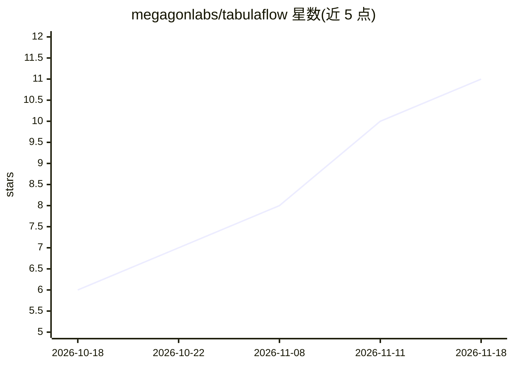

# megagonlabs/tabulaflow

⭐ 11 · Python · NOASSERTION · 推送 2026-11-17 · [GitHub](https://github.com/megagonlabs/tabulaflow) · [官网](https://megagonlabs.github.io/tabulaflow/) · 组织维护

**面向数据分析的自然语言数据代理应用与构建库**

TabulaFlow 提供一个开源数据代理应用与 Python 库：用户用自然语言描述要分析、可视化或转换的数据，代理生成查询与可视化规格，工具负责数据解析、渲染与溯源记录，支持 SQL/图数据库、文件、Hugging Face 数据集、Wikidata 与网页。核心 harness 不依赖 shell，表格为一等公民。库层提供数据连接器、提取/富化、ChatSession、结构化输出等构建块；另有面向文本到 SQL 研究者的基准评测扩展（BIRD-SQL、Spider 2.0 等）。安装需 uv 并设置模型 provider key；不带 LLM 也可直接浏览数据。

## 筛选速览

| 维度 | 判定 | 备注 |
|---|---|---|
| AI 角色 | `ai-native` | 本体是模型或模型工具 |
| 许可风险 | `none` | NOASSERTION |
| 部署形态 | `library` | 以包/库形式分发 |
| 模型依赖 | — | README 未给出锁定关系 |
| 硬件要求 | — | 无带数字的原话,不猜 |
| 安装摩擦 | `low` | 无编译、无系统依赖或容器化 |
| 成熟度 | — | 结构信号不足 |

## 能力要点

- 数据代理模式：文本到查询、数据绑定可视化、交互式仪表板、抽取、行级富化、跨源连接
- 库层构建块：数据连接器、结构化输出、ChatSession（含上下文压缩）
- Research 扩展支持 BIRD-SQL、Spider 2.0、CypherBench 等基准与官方榜单指标
- 无 LLM/API key 模式下可直接查询与浏览数据

## 适用场景

- 用自然语言查询和可视化数据库、文件与知识图谱数据
- 构建与数据源绑定的交互式仪表板
- 从超上下文窗口的非结构化内容抽取结构化记录
- 运行 text-to-SQL 基准实验并记录轨迹与指标

## 场景标签

`数据分析` `模型评测` `知识图谱` · 领域:效率与自动化

## 证据(README 行号)

> L9: TabulaFlow is an open-source data agent application, as well as a library for building data agents.
> L12: Think of it as Claude Code for data: describe in natural language what you want
> L49:  Text-to-query Turn natural-language requests into query-backed data tables.

## 星数曲线

2026-10-18 6 → 2026-11-18 11（+5）

---
*卡片 v1 · prompt 1.4 · 生成 2026-11-18 · 置信度 high · 依据 README sha `27ce77a3a01a` · [字段定义](../../DATASET.md)*
