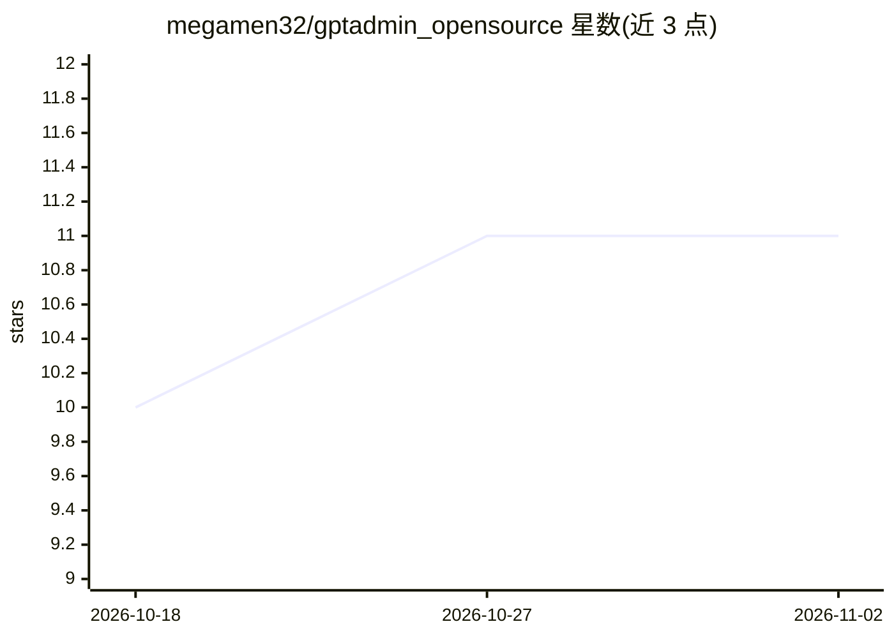

# megamen32/gptadmin_opensource

⭐ 11 · Go · AGPL-3.0 · 推送 2026-11-01 · [GitHub](https://github.com/megamen32/gptadmin_opensource) · [官网](https://became.bezrabotnyi.com) · 个人维护

**自托管 MCP hub：让多种 AI 助手统一控制服务器基础设施**

自托管的 MCP hub 进程，位于 AI 助手与用户服务器之间：MCP 工具接入 hub，AI 通过三种适配器（OpenAI Action、MCP remote SSE、浏览器扩展）连接同一 hub，能力包括服务器管理、代码执行、日志分析、子代理与 Code Mode（JavaScript 链式调用 MCP）。支持连接 ChatGPT、Claude、Codex、DeepSeek、Qwen、Yandex Alice、GigaChat 等客户端。安装提供 curl/PowerShell 脚本（自动探测用户/系统模式，含 FRP/Cloudflare 自动隧道），也可从源码运行；AGPL-3.0 许可。限制：failover 为降级而非多主复制；仓库结构仍在整理中（见 OPEN_CORE_PLAN）。

## 筛选速览

| 维度 | 判定 | 备注 |
|---|---|---|
| AI 角色 | `ai-ecosystem` | LLM/agent 周边工具 |
| 许可风险 | `viral` | AGPL-3.0 |
| 部署形态 | `library` | 以包/库形式分发 |
| 模型依赖 | locked-api |  |
| 硬件要求 | — | 无带数字的原话,不猜 |
| 安装摩擦 | `low` | 无编译、无系统依赖或容器化 |
| 成熟度 | — | 结构信号不足 |

## 能力要点

- 三种适配器（OpenAI Action / MCP remote SSE / 浏览器扩展）连接同一 hub
- 服务器管理、代码执行、日志解析、子代理启动、Code Mode 脚本链式调用
- 安装脚本自动探测用户/系统模式，FRP 或 Cloudflare 自动隧道生成公开 URL
- 降级 failover：备用节点在主 hub 故障后接管控制面

## 适用场景

- 让 ChatGPT/Claude 等 AI 直接执行服务器运维命令并回传实际输出
- 把多个 MCP 工具聚合到一处供不同 AI 客户端共用
- 通过免费网页版聊天（浏览器扩展）控制自有服务器

## 场景标签

 · 领域:AI 基础设施/MCP 服务器管理

## 证据(README 行号)

> L10: GPT‑Админ is a self-hosted MCP hub that sits between your AI assistant and your
> L47: The hub is one process. Tools plug into it. AIs connect to it via one of three
> L141: |**MCP remote SSE**|Claude Desktop, Codex, OpenCode|Hub is an MCP server (Streamable HTTP). Add to `claude_desktop

## 星数曲线

2026-10-18 10 → 2026-11-02 11（+1）

---
*卡片 v1 · prompt 1.4 · 生成 2026-11-02 · 置信度 mid · 依据 README sha `84d6ed27317e` · [字段定义](../../DATASET.md)*
