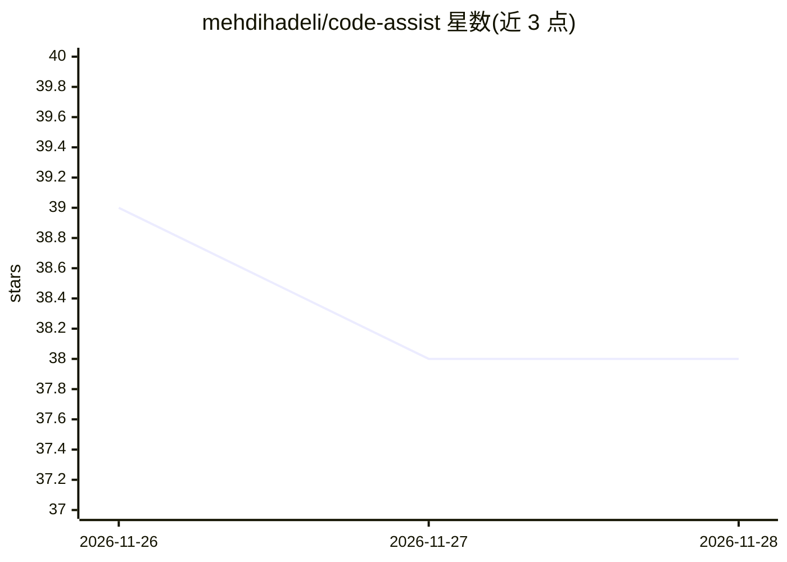

# mehdihadeli/code-assist

⭐ 38 · C# · 推送 2026-11-25 · [GitHub](https://github.com/mehdihadeli/code-assist) · [官网](https://mehdihadeli.github.io/code-assist/) · 个人维护

**.NET 终端 AI 编程助手：CLI+VS Code 接本地/在线模型**

基于 .NET 10 的命令行编程助手，带原生 VS Code 扩展，两者通过认证本地 HTTP 连接同一服务端以访问模型提供商和会话。功能覆盖提供商配置、模型/工具目录查看、连接器管理、流式 `run`/`chat` 对话、命名空间化提示词与插件系统、本地 Agent Server（JSON/SSE、持久会话）。从源码构建，不发布 NuGet 包。工作区代码编辑、审批、全屏终端 UI、vault/OAuth 登录等功能尚未实现。

## 筛选速览

| 维度 | 判定 | 备注 |
|---|---|---|
| AI 角色 | `ai-ecosystem` | LLM/agent 周边工具 |
| 许可风险 | `none` | — |
| 部署形态 | `None` |  |
| 模型依赖 | locked-api |  |
| 硬件要求 | — | 无带数字的原话,不猜 |
| 安装摩擦 | `medium` | 含编译或系统依赖之一 |
| 成熟度 | — | 结构信号不足 |

## 能力要点

- CLI 与 VS Code 扩展共享同一本地服务端与会话存储
- SDK 层支持 OpenAI、Anthropic、Azure、Google/Gemini、Vertex、Bedrock
- 声明式插件包（digest 审批机制，默认禁用安装）
- 托管服务关闭的进程树清理机制，663 项 CLI 集成测试

## 适用场景

- 在终端用本地或在线模型进行代码解释、重构、审查与调试对话
- 通过本地 Agent Server 提供会话 API 给多客户端使用
- 构建并分发团队内部审核类插件提示词包

## 场景标签

`AI 助手` `提示工程` · 领域:Agent 开发

## 证据(README 行号)

> L3: A .NET 10 coding assistant with a command-line interface and a native VS Code extension. Both connect to the same lo
> L54: SDK-backed provider components support OpenAI chat/Responses and compatible routes, Anthropic, Azure, Google/Gemini

## 星数曲线

2026-11-26 39 → 2026-11-28 38（-1）

---
*卡片 v1 · prompt 1.4 · 生成 2026-11-26 · 置信度 high · 依据 README sha `d9f5155e51a4` · [字段定义](../../DATASET.md)*
