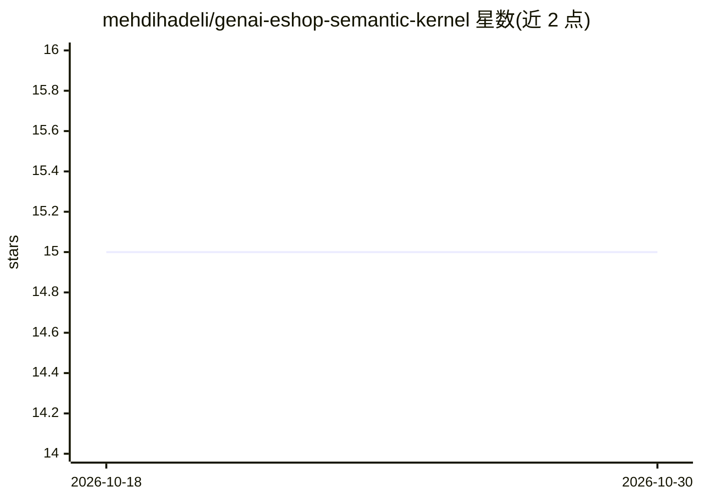

# mehdihadeli/genai-eshop-semantic-kernel

⭐ 15 · C# · MIT · 推送 2026-09-13 · [GitHub](https://github.com/mehdihadeli/genai-eshop-semantic-kernel) · 个人维护

**Semantic Kernel 多智能体 GenAI 电商示例应用（.NET Aspire）**

基于 .NET 的生成式 AI 电商参考应用：使用 Semantic Kernel 做多智能体编排（Parent-Child、GroupChat、Sequential）、MCP 工具调用、A2A 协议外部智能体通信，并通过 Qdrant 连接器做语义与混合搜索。ChatCompletion 与 Embedding 可切换 Ollama、AzureOpenAI、OpenAI 或任意 OpenAI 兼容 /v1 端点。采用 Vertical Slice 架构、Minimal APIs、OpenTelemetry 与 .NET Aspire 编排，可用 Aspire CLI 或 docker-compose 运行。注意 README 声明本应用已迁移到 microsoft/agent-framework 版本仓库。

## 筛选速览

| 维度 | 判定 | 备注 |
|---|---|---|
| AI 角色 | `ai-ecosystem` | LLM/agent 周边工具 |
| 许可风险 | `permissive` | MIT |
| 部署形态 | `None` |  |
| 模型依赖 | local-ok | 支持本地模型 |
| 硬件要求 | — | 无带数字的原话,不猜 |
| 安装摩擦 | `medium` | 含编译或系统依赖之一 |
| 成熟度 | — | 结构信号不足 |

## 能力要点

- Semantic Kernel 多智能体编排（Parent-Child/GroupChat/Sequential）
- MCP 工具（http + json-rpc）与 A2A 协议外部智能体通信
- Qdrant 向量库支持语义搜索与混合搜索
- ChatCompletion/Embedding 可选 Ollama、AzureOpenAI、OpenAI 及 OpenAI 兼容端点

## 适用场景

- 学习 Semantic Kernel 多智能体编排的完整落地实现
- 参考 .NET Aspire 下 GenAI 微服务架构与可观测性实践
- 以 OpenAI 兼容本地端点（如 Ollama）做本地开发测试

## 场景标签

`多智能体` `语义搜索` `教程课程` · 领域:Agent 开发

## 证据(README 行号)

> L13: - ✅ Using microsoft/semantic-kernel for multi-agent orchestrations and AI related services
> L15: - ✅ Using Semantic Kernel `EmbeddingGenerator` based on chosen providers like `Ollama`, `AzureOpenAI`, and `OpenAI`

## 星数曲线

2026-10-18 15 → 2026-10-30 15（+0）

---
*卡片 v1 · prompt 1.4 · 生成 2026-10-30 · 置信度 high · 依据 README sha `2b1a7482ae85` · [字段定义](../../DATASET.md)*
