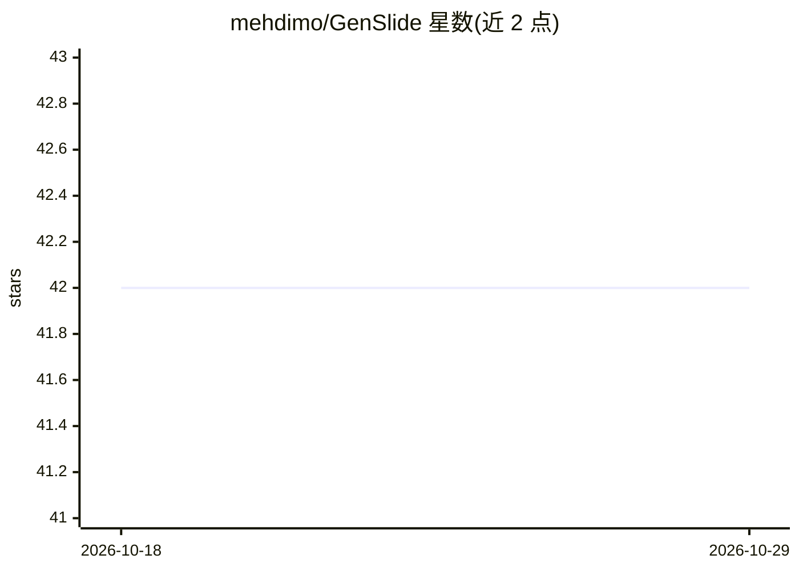

# mehdimo/GenSlide

⭐ 42 · Python · MIT · 推送 2026-03-13 · [GitHub](https://github.com/mehdimo/GenSlide) · 个人维护

**文本/文档生成 PowerPoint 幻灯片的 LangGraph Agent 应用**

基于 LangGraph 多节点 Agent 管道与 GPT-4o 的幻灯片生成应用：输入纯文本、PDF 或 DOCX，经解析、规划（编排 Agent 决定幻灯片数量与顺序）、内容填充（并发 GPT-4o 调用生成要点与演讲备注）到构建 .pptx 文件，含人工审核环节——可在 Streamlit UI 中批准或提出修改意见，Agent 做针对性编辑。也支持通过 LLM_PROVIDER=local 切换本地 LLM（详见 v0.1.0）。以 Python 源码形式提供，需 OpenAI API key，通过 Streamlit 运行。

## 筛选速览

| 维度 | 判定 | 备注 |
|---|---|---|
| AI 角色 | `ai-native` | 本体是模型或模型工具 |
| 许可风险 | `permissive` | MIT |
| 部署形态 | `library` | 以包/库形式分发 |
| 模型依赖 | — | README 未给出锁定关系 |
| 硬件要求 | — | 无带数字的原话,不猜 |
| 安装摩擦 | `low` | 无编译、无系统依赖或容器化 |
| 成熟度 | — | 结构信号不足 |

## 能力要点

- LangGraph 多节点 Agent 管道：编排、内容生成、修订分工
- 并发 GPT-4o 调用，10 页与 1 页生成耗时接近
- 人工在环审核：批准或提出修改意见，Agent 做局部编辑
- 支持本地 LLM（LLM_PROVIDER=local）与 OpenAI 两种模式

## 适用场景

- 把文章或 PDF/DOCX 文档快速转成可编辑的 PPT
- 通过对话式修改意见迭代幻灯片草稿
- 接入本地 LLM 离线生成幻灯片

## 场景标签

`AI 写作` · 领域:内容生成

## 证据(README 行号)

> L3: > Text and document to PowerPoint slide generation powered by a **LangGraph agentic pipeline** and **GPT-4o**.
> L18: The **orchestrator** decides how many slides are needed and what order they should go in. The **content agent** fil
> L81: 1. **Provide your content** — paste plain text, or upload a PDF or DOCX file.

## 星数曲线

2026-10-18 42 → 2026-10-29 42（+0）

---
*卡片 v1 · prompt 1.4 · 生成 2026-10-25 · 置信度 mid · 依据 README sha `8d54240ce955` · [字段定义](../../DATASET.md)*
