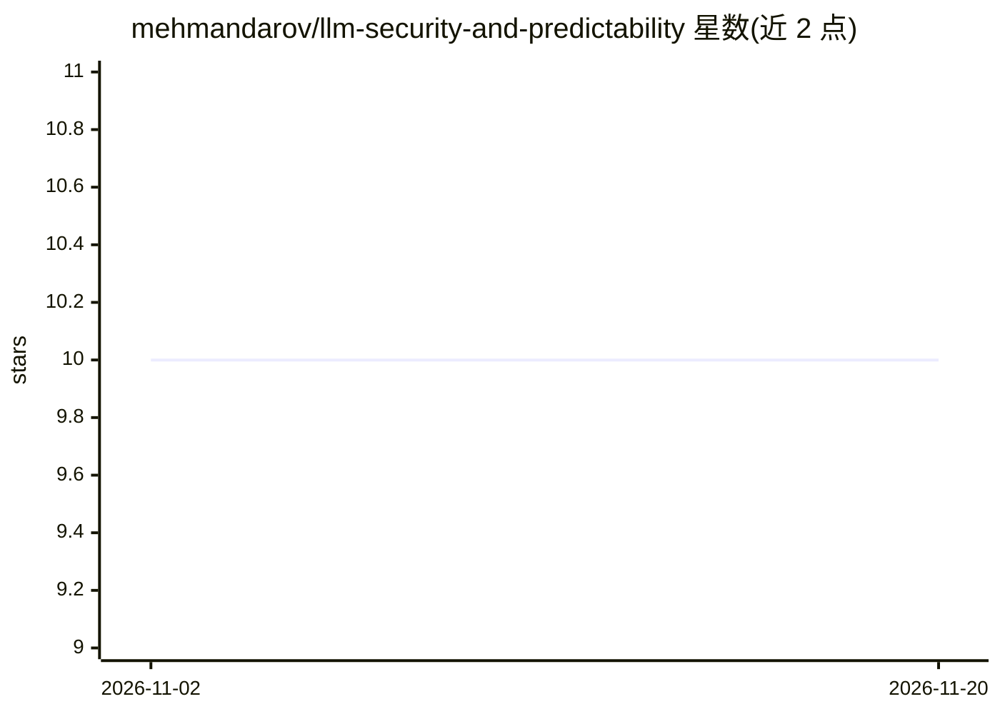

# mehmandarov/llm-security-and-predictability

⭐ 10 · Java · GPL-3.0 · 推送 2026-11-18 · [GitHub](https://github.com/mehmandarov/llm-security-and-predictability) · 个人维护

**Java 开发者的 LLM 应用安全与确定性模式示例集**

这是演讲《Taming the Chaos》的配套演示代码库，以 Java/JUnit 测试形式组织为按章节递进的示例：从朴素实现出发，依次演示护栏（提示注入检测、PII 脱敏、金丝雀令牌）、确定性校验与工具计算、自我纠错反馈环、多模型多数投票与稳定性测量，以及

## 筛选速览

| 维度 | 判定 | 备注 |
|---|---|---|
| AI 角色 | `ai-knowledge` | 知识聚合/清单类 |
| 许可风险 | `viral` | GPL-3.0 |
| 部署形态 | `None` |  |
| 模型依赖 | local-ok | 支持本地模型 |
| 硬件要求 | — | 无带数字的原话,不猜 |
| 安装摩擦 | `medium` | 含编译或系统依赖之一 |
| 成熟度 | — | 结构信号不足 |

## 能力要点

- 按章节组织的 5+1 阶段防护模式示例（护栏、金丝雀、校验、自纠错、共识）
- 基于 LangChain4j 与 Jakarta Validation 的 Java 实现
- 单元测试用 mock 模型运行，端到端测试可接本地 Ollama（不可达时自动跳过）
- 含确定性数学工具与种子可复现性测试（temperature=0 + seed=42）

## 适用场景

- 为 Java 应用接入 LLM 时参考输入输出防护的代码示例
- 演示提示注入、PII 泄露等攻击及对应护栏
- 学习用确定性代码校验与多模型共识降低输出不确定性

## 场景标签

`网络安全` · 领域:学习与行业

## 证据(README 行号)

> L3: This repository contains the demo code and examples for the talk **"Taming the Chaos"**. It demonstrates practical p
> L44: The code is organized by **Chapters** corresponding to the narrative of the talk:

## 星数曲线

2026-11-02 10 → 2026-11-20 10（+0）

---
*卡片 v1 · prompt 1.4 · 生成 2026-11-19 · 置信度 high · 依据 README sha `379505fcc8cb` · [字段定义](../../DATASET.md)*
