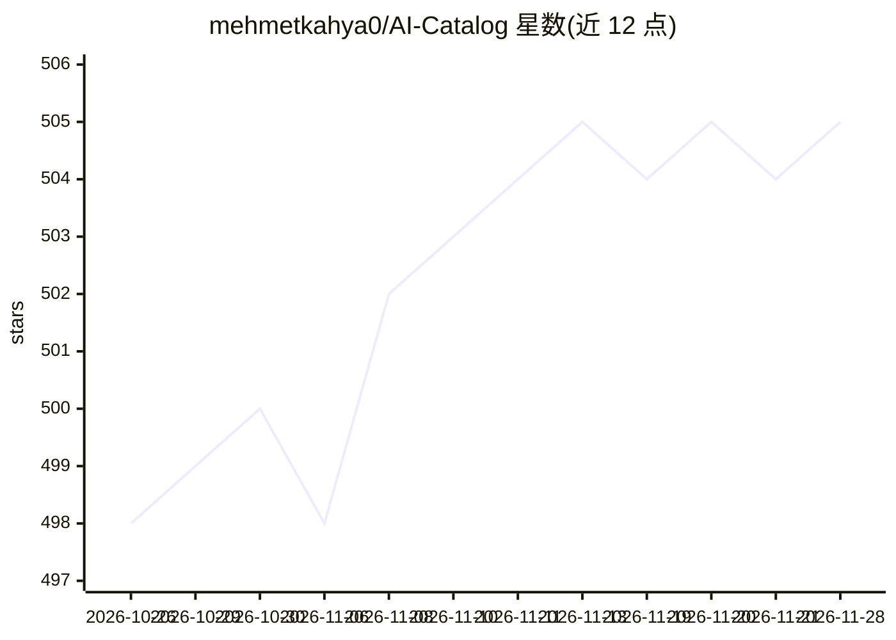

# mehmetkahya0/AI-Catalog

⭐ 505 · HTML · GPL-3.0 · 推送 2026-11-27 · [GitHub](https://github.com/mehmetkahya0/AI-Catalog) · [官网](https://mehmetkahya0.github.io/AI-Catalog/) · 个人维护

**面向 AI 工具使用者的 500+ 工具在线目录清单**

以 awesome-list 形式组织的 AI 工具、平台与资源目录，声称收录 500+ 条目、40+ 类别，覆盖创意生成、助手聊天、LLM、内容写作、教育、开发者工具等。每条目附 Free/Paid/Freemium 等标签，并提供可搜索、可筛选的 GitHub Pages 在线版本。由维护者自行浏览收集条目，更新频率取决于个人浏览；README 声明部分条目由 Claude Sonnet 4 协助编写脚本。仓库本身不提供工具的安装或运行方式。

## 筛选速览

| 维度 | 判定 | 备注 |
|---|---|---|
| AI 角色 | `ai-knowledge` | 知识聚合/清单类 |
| 许可风险 | `viral` | GPL-3.0 |
| 部署形态 | `None` |  |
| 模型依赖 | — | README 未给出锁定关系 |
| 硬件要求 | — | 无带数字的原话,不猜 |
| 安装摩擦 | `low` | 无编译、无系统依赖或容器化 |
| 成熟度 | `idea` | |

## 能力要点

- 500+ 条 AI 工具/平台条目，40+ 分类组织
- 每条目标注 Free/Paid/Freemium/New/Popular 图例
- 提供 GitHub Pages 在线可搜索、可筛选版本
- 开放 PR 贡献

## 适用场景

- 按类别浏览查找某领域的 AI 工具
- 查找本地自托管的开源 LLM 方案
- 了解文本生成图像、视频摘要等细分工具选项

## 场景标签

`精选清单` · 领域:学习与行业

## 证据(README 行号)

> L3: > **A comprehensive, curated collection of 500+ AI tools, platforms, and resources across 40+ categories**
> L7: *Your one-stop destination for discovering the best AI tools across all domains - from creative AI to developer tool

## 星数曲线

2026-10-26 498 → 2026-11-28 505（+7）

---
*卡片 v1 · prompt 1.4 · 生成 2026-11-28 · 置信度 high · 依据 README sha `b57354f15a17` · [字段定义](../../DATASET.md)*
