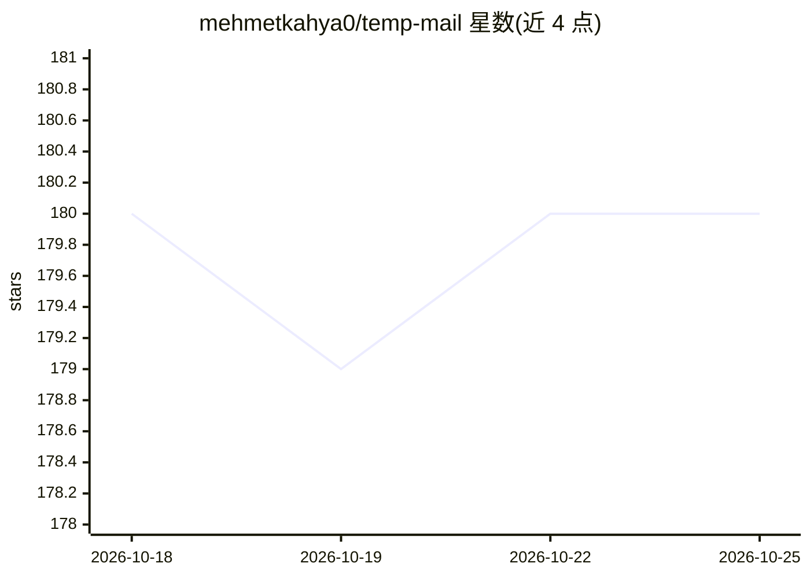

# mehmetkahya0/temp-mail

⭐ 181 · JavaScript · NOASSERTION · 推送 2026-05-22 · [GitHub](https://github.com/mehmetkahya0/temp-mail) · [官网](https://mehmetkahya0.github.io/temp-mail/) · 个人维护

**临时邮箱 Web 应用：生成一次性邮箱并查看收到的邮件**

纯 HTML5/CSS3/JavaScript 实现的一次性邮箱前端应用，调用 Guerrilla Mail API 收信。支持同时管理最多 5 个临时邮箱标签页、命令面板（Ctrl+K）快捷操作、按关键词正则将邮件分类为验证/安全/测试/营销四类语义标签、邮件星标与快速过滤、TR/EN 双语。本地运行需 git clone 后用 live-server 或直接打开 index.html。采用带商业限制的特殊许可，商用需作者许可，且声明禁止复制代码另开同类网站。

## 筛选速览

| 维度 | 判定 | 备注 |
|---|---|---|
| AI 角色 | `ai-enhanced` | 去掉 AI 部分产品仍成立 |
| 许可风险 | `none` | NOASSERTION |
| 部署形态 | `library` | 以包/库形式分发 |
| 模型依赖 | — | README 未给出锁定关系 |
| 硬件要求 | — | 无带数字的原话,不猜 |
| 安装摩擦 | `low` | 无编译、无系统依赖或容器化 |
| 成熟度 | — | 结构信号不足 |

## 能力要点

- 同时管理最多 5 个临时邮箱，会话本地缓存与切换
- Ctrl+K 命令面板与全键盘快捷操作
- 按 Subject/From 正则匹配自动打四类语义标签
- TR/EN 双语与深色模式切换

## 适用场景

- 注册网站时用一次性邮箱避免暴露真实邮箱
- 集中收取多个验证码/激活邮件并快速过滤
- 开发测试中接收沙箱测试邮件

## 场景标签

 · 领域:隐私/临时邮箱 Web 工具

## 证据(README 行号)

> L48: * **Semantic Label Classifiers**: Real-time evaluation automatically highlights incoming messages based on semantic
> L139: function detectEmailTags(subject, from) {
> L67: * **Localization**: Integrated instant TR/EN multi-lingual engine.

## 星数曲线

2026-10-18 180 → 2026-10-25 180（+0）

---
*卡片 v1 · prompt 1.4 · 生成 2026-10-22 · 置信度 low · 依据 README sha `14d9b36138b8` · [字段定义](../../DATASET.md)*
