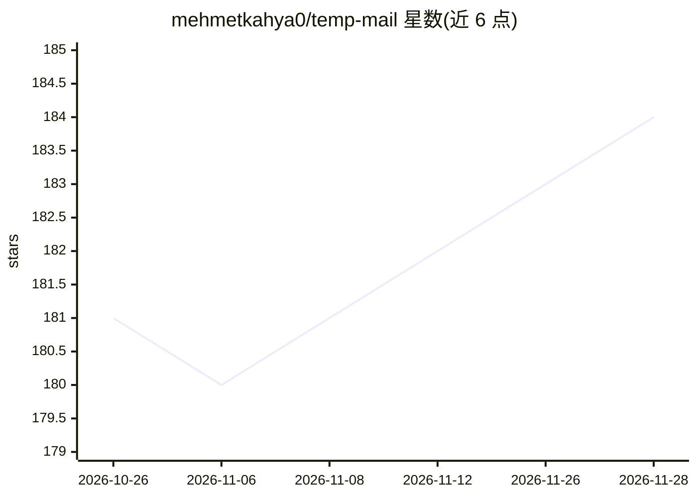

# mehmetkahya0/temp-mail

⭐ 184 · JavaScript · NOASSERTION · 推送 2026-10-28 · [GitHub](https://github.com/mehmetkahya0/temp-mail) · [官网](https://mehmetkahya0.github.io/temp-mail/) · 个人维护

**隐私优先的一次性临时邮箱 Web 应用，一键生成收件并提取验证码**

纯前端的一次性邮箱应用：浏览器直接调用 Guerrilla Mail API，无后端、无账号、零依赖、零构建步骤，状态保存在浏览器本地。支持最多 5 个邮箱标签、7 个域名、自定义用户名、QR 码分享；基于关键词规则从邮件主题与预览中提取 4–8 位验证码并一键复制，可识别英/土两种语言。隐私屏蔽会清除追踪像素、拦截远程图片，并对短链、裸 IP、punycode 等可疑链接打标。邮件由 Guerrilla Mail 侧 60 分钟后删除，界面提供 EN/TR 双语与 PWA 安装。

## 筛选速览

| 维度 | 判定 | 备注 |
|---|---|---|
| AI 角色 | `ai-enhanced` | 去掉 AI 部分产品仍成立 |
| 许可风险 | `none` | NOASSERTION |
| 部署形态 | `None` |  |
| 模型依赖 | — | README 未给出锁定关系 |
| 硬件要求 | — | 无带数字的原话,不猜 |
| 安装摩擦 | `low` | 无编译、无系统依赖或容器化 |
| 成熟度 | — | 结构信号不足 |

## 能力要点

- 无后端、无账号、零依赖零构建，浏览器直连 Guerrilla Mail API
- 基于关键词规则的验证码检测与一键复制（支持英文与土耳其语）
- 隐私屏蔽：清除追踪像素、默认拦截远程图片与脚本/iframe
- 可疑链接标记（短链、裸 IP、punycode、文本与目标域名不符）

## 适用场景

- 注册试用、论坛或 Wi-Fi 门户时不暴露真实邮箱
- 快速接收并复制邮箱验证码
- 测试自己应用的注册、密码重置或邮件营销发送
- 打开不信任的邮件时剥离追踪器并核验链接真实去向

## 场景标签

 · 领域:隐私/邮件工具

## 证据(README 行号)

> L43: TempMail is a privacy-first **disposable email web app**. It creates a throwaway address instantly, shows incoming 
> L203: |1. Find a keyword|`code`, `otp`, `pin`, `verification`, `passcode`, `token`, and Turkish stems with suffixes: `ko

## 星数曲线

2026-10-26 181 → 2026-11-28 184（+3）

---
*卡片 v1 · prompt 1.4 · 生成 2026-11-26 · 置信度 high · 依据 README sha `bcb6e96cdb1c` · [字段定义](../../DATASET.md)*
