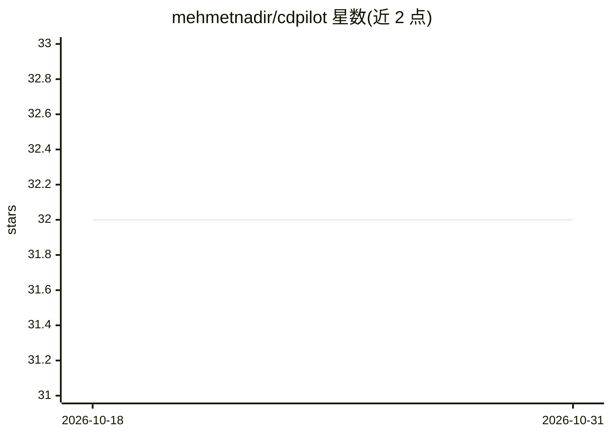

# mehmetnadir/cdpilot

⭐ 32 · Python · MIT · 推送 2026-10-16 · [GitHub](https://github.com/mehmetnadir/cdpilot) · [官网](https://cdpilot.ndr.ist) · 个人维护

**零依赖的浏览器自动化 CLI，基于原生 CDP，含 MCP 服务器**

终端浏览器自动化工具：直接通过 Chrome DevTools Protocol over HTTP 控制 Brave/Chrome/Chromium，不依赖 Puppeteer/Playwright/Selenium，npm 依赖为 0。提供 70+ 命令（导航、点击、输入、截图、网络、控制台、无障碍、iframe 内跨源元素定位），支持按可见文本点击/填充、测试断言、独立 profile 会话与多项目隔离，并提供 MCP 服务器供 AI 编码 agent（如 Claude Code）调用。安装即 npx 或 npm i -g，需 Node.js 18+、Python 3.10+ 与本地浏览器。

## 筛选速览

| 维度 | 判定 | 备注 |
|---|---|---|
| AI 角色 | `ai-ecosystem` | LLM/agent 周边工具 |
| 许可风险 | `permissive` | MIT |
| 部署形态 | `library` | 以包/库形式分发 |
| 模型依赖 | locked-api |  |
| 硬件要求 | — | 无带数字的原话,不猜 |
| 安装摩擦 | `low` | 无编译、无系统依赖或容器化 |
| 成熟度 | — | 结构信号不足 |

## 能力要点

- 纯 CDP over HTTP，0 npm 依赖，不含 Puppeteer/Playwright/Selenium
- 70+ 命令覆盖导航、交互、截图、PDF、网络与 iframe 跨源定位
- 内建 MCP 服务器（npx cdpilot mcp）供 AI 编码 agent 调用
- 按工作负载自动选择浏览器（Vivaldi/Brave/Edge/Chromium/Chrome/CfT）

## 适用场景

- 在终端用 npx 快速做浏览器操作与截图
- 让 Claude Code 等 AI agent 通过 MCP 控制浏览器
- 做 E2E 测试断言与跨 iframe（如支付卡表单）的自动化

## 场景标签

`浏览器自动化` · 领域:效率与自动化

## 证据(README 行号)

> L9: MCP Compatible
> L31: - **AI-agent friendly** — Designed for Claude, GPT, Gemini, and any LLM tool-use workflow
> L137: This registers the `cdpilot` MCP server (`npx cdpilot mcp`) and a short skill

## 星数曲线

2026-10-18 32 → 2026-10-31 32（+0）

---
*卡片 v1 · prompt 1.4 · 生成 2026-10-26 · 置信度 mid · 依据 README sha `105c37efdb48` · [字段定义](../../DATASET.md)*
