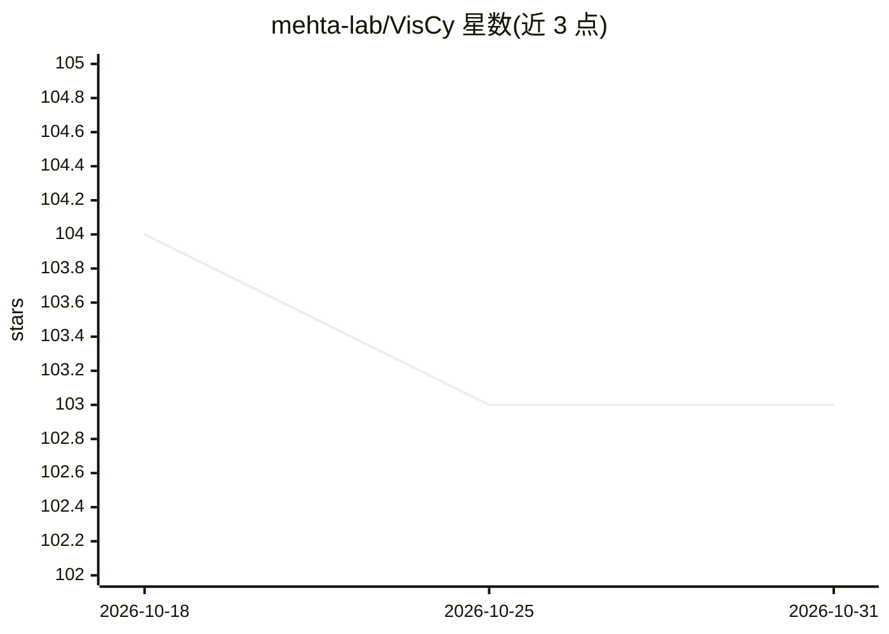

# mehta-lab/VisCy

⭐ 103 · Jupyter Notebook · BSD-3-Clause · 推送 2026-10-29 · [GitHub](https://github.com/mehta-lab/VisCy) · [官网](https://mehta-lab.github.io/VisCy/) · 组织维护

**显微镜图像单细胞表型的计算机视觉模型训练与部署管线**

VisCy 是面向显微图像的深度学习管线，用于训练和部署单细胞分辨率的图像表型计算机视觉模型。以 uv workspace monorepo 组织为四个可独立 pip 安装的包：viscy-data（数据加载与 Lightning DataModules）、viscy-models（UNet、对比学习、VAE 等网络架构）、viscy-transforms（GPU 加速图像变换）、viscy-utils（共享 ML 基础设施）。另含两个应用：Cytoland（从无标记图像虚拟染色细胞器）与 DynaCLR（细胞动力学的自监督对比学习）。BSD-3-Clause 许可。

## 筛选速览

| 维度 | 判定 | 备注 |
|---|---|---|
| AI 角色 | `ai-native` | 本体是模型或模型工具 |
| 许可风险 | `permissive` | BSD-3-Clause |
| 部署形态 | `library` | 以包/库形式分发 |
| 模型依赖 | — | README 未给出锁定关系 |
| 硬件要求 | — | 无带数字的原话,不猜 |
| 安装摩擦 | `low` | 无编译、无系统依赖或容器化 |
| 成熟度 | — | 结构信号不足 |

## 能力要点

- 四个可独立安装的子包：数据、模型架构、GPU 变换、共享基础设施
- Cytoland：从 label-free 图像虚拟染色细胞器
- DynaCLR：面向细胞动力学的自监督对比学习
- 提供 UNet、对比学习、VAE 架构

## 适用场景

- 训练显微镜图像的单细胞表型识别模型
- 从无标记显微图像生成细胞器虚拟染色
- 用自监督对比学习表征细胞动态过程

## 场景标签

`模型训练` `图像生成` · 领域:内容生成

## 证据(README 行号)

> L10: VisCy (blend of `vision` and `cyto`) is a deep learning pipeline for training and deploying computer vision models 
> L27: |Cytoland|Robust virtual staining of organelles from label-free images|`uv pip install -e "applications/cytoland"`|

## 星数曲线

2026-10-18 104 → 2026-10-31 103（-1）

---
*卡片 v1 · prompt 1.4 · 生成 2026-10-23 · 置信度 high · 依据 README sha `24b9f9522703` · [字段定义](../../DATASET.md)*
