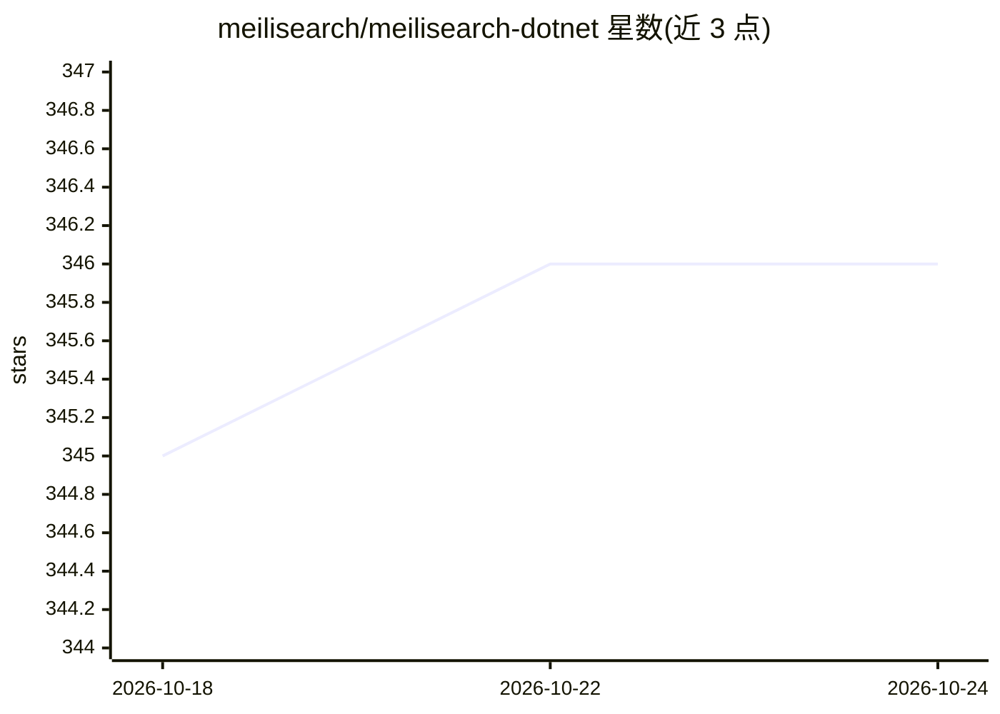

# meilisearch/meilisearch-dotnet

⭐ 347 · C# · MIT · 推送 2026-10-14 · [GitHub](https://github.com/meilisearch/meilisearch-dotnet) · [官网](https://meilisearch.com) · 组织维护

**Meilisearch 搜索引擎的官方 .NET/C# 客户端 SDK**

由 Meilisearch 官方维护的 .NET API 客户端（NuGet 包 MeiliSearch），面向 C# 开发者，用于从 .NET 应用中接入 Meilisearch 搜索引擎：覆盖索引创建与管理、文档增删改查、基础与自定义搜索（过滤、分页、排序）、任务状态查询，支持替换默认 HttpClient。声明兼容 Meilisearch v1.x，部分特性可能缺失。目标框架为 .NET Standard 2.1。

## 筛选速览

| 维度 | 判定 | 备注 |
|---|---|---|
| AI 角色 | `ai-ecosystem` | LLM/agent 周边工具 |
| 许可风险 | `permissive` | MIT |
| 部署形态 | `None` |  |
| 模型依赖 | — | README 未给出锁定关系 |
| 硬件要求 | — | 无带数字的原话,不猜 |
| 安装摩擦 | `medium` | 含编译或系统依赖之一 |
| 成熟度 | — | 结构信号不足 |

## 能力要点

- 索引、文档、任务管理的完整 API 封装
- 搜索支持过滤、limit/offset 与 page 分页、多属性排序
- 可注入自定义 HttpClient（如 ClientFactory 创建的实例）
- 官方维护，声明兼容 Meilisearch v1.x

## 适用场景

- 在 .NET 项目中为应用接入 Meilisearch 搜索
- 从 C# 代码管理索引与文档并执行带过滤/分页/排序的搜索
- 替换默认 HttpClient 以复用应用的 HTTP 基础设施

## 场景标签

 · 领域:搜索/数据基础设施

## 证据(README 行号)

> L17:  ⚡ The Meilisearch API client written for .NET
> L19: **Meilisearch .NET** is the Meilisearch API client for C# developers.
> L296: **Meilisearch** provides and maintains many **SDKs and Integration tools** like this one. We want to provide every

## 星数曲线

2026-10-18 345 → 2026-10-24 346（+1）

---
*卡片 v1 · prompt 1.4 · 生成 2026-10-21 · 置信度 high · 依据 README sha `b9df4de32f96` · [字段定义](../../DATASET.md)*
