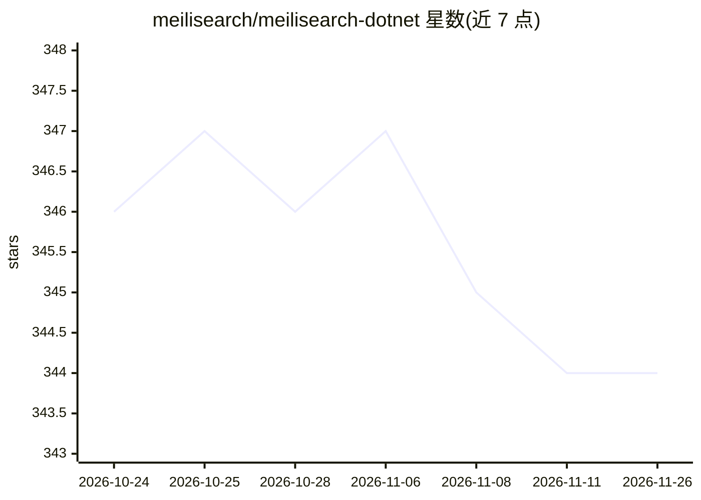

# meilisearch/meilisearch-dotnet

⭐ 344 · C# · MIT · 推送 2026-11-11 · [GitHub](https://github.com/meilisearch/meilisearch-dotnet) · [官网](https://meilisearch.com) · 组织维护

**.NET 开发者的 Meilisearch 搜索引擎 API 客户端**

面向 C#/.NET 开发者的 Meilisearch 官方 API 客户端（SDK），以 NuGet 包分发，目标 .NET Standard 2.1。封装索引创建、文档增删改查、任务状态查询等操作，支持基础搜索、自定义搜索参数、过滤器、分页（limit/offset 与 page/hitsPerPage）和排序。可替换自定义 HttpClient，支持 Gzip/Deflate/Brotli 请求压缩（部分算法仅 .NET 6 构建提供）。兼容 Meilisearch v1.x 版本。

## 筛选速览

| 维度 | 判定 | 备注 |
|---|---|---|
| AI 角色 | `ai-enhanced` | 去掉 AI 部分产品仍成立 |
| 许可风险 | `permissive` | MIT |
| 部署形态 | `None` |  |
| 模型依赖 | — | README 未给出锁定关系 |
| 硬件要求 | — | 无带数字的原话,不猜 |
| 安装摩擦 | `medium` | 含编译或系统依赖之一 |
| 成熟度 | — | 结构信号不足 |

## 能力要点

- 通过 NuGet 分发，提供 dotnet CLI 与 Package Manager 两种安装方式
- 封装索引/文档/任务管理 API 与多种搜索查询方式（过滤、排序、分页）
- 支持自定义 HttpClient 替换默认实现
- 支持 Gzip/Deflate/Brotli HTTP 请求压缩，默认 1400 字节阈值

## 适用场景

- 在 .NET 应用中接入 Meilisearch 实现站内搜索
- 对索引中的文档执行增删改查与批量操作
- 在 C# 中执行带过滤器、排序和分页的搜索查询

## 场景标签

 · 领域:搜索/开发工具

## 证据(README 行号)

> L17:  ⚡ The Meilisearch API client written for .NET
> L19: **Meilisearch .NET** is the Meilisearch API client for C# developers.
> L33: This package targets .NET Standard 2.1.

## 星数曲线

2026-10-24 346 → 2026-11-26 344（-2）

---
*卡片 v1 · prompt 1.4 · 生成 2026-11-25 · 置信度 high · 依据 README sha `9039b3ca1cce` · [字段定义](../../DATASET.md)*
