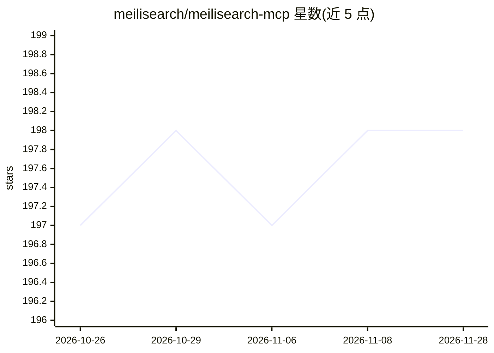

# meilisearch/meilisearch-mcp

⭐ 198 · Python · MIT · 推送 2026-10-28 · [GitHub](https://github.com/meilisearch/meilisearch-mcp) · 组织维护

**让 LLM 客户端通过自然语言管理 Meilisearch 的 MCP 服务器**

基于官方 MCP Python SDK 的 stdio 服务器，使任何 MCP 兼容客户端（Claude Desktop、OpenAI agents 等）能以对话方式管理 Meilisearch：索引与文档增删、单/多索引搜索（含语义与混合搜索）、相关性设置、API 密钥管理、任务与健康监控。通过环境变量配置默认连接，支持动态切换实例。README 声明该包已弃用——Meilisearch v1.54 起内置原生 MCP 服务器，本仓库仅为存量用户保留，不再维护。

## 筛选速览

| 维度 | 判定 | 备注 |
|---|---|---|
| AI 角色 | `ai-ecosystem` | LLM/agent 周边工具 |
| 许可风险 | `permissive` | MIT |
| 部署形态 | `self-host` | docker 或自建部署 |
| 模型依赖 | — | README 未给出锁定关系 |
| 硬件要求 | — | 无带数字的原话,不猜 |
| 安装摩擦 | `low` | 无编译、无系统依赖或容器化 |
| 成熟度 | — | 结构信号不足 |

## 能力要点

- 覆盖索引/文档/搜索/设置/API 密钥/任务监控的完整工具集
- 支持单/多索引、语义与混合搜索
- 基于官方 MCP Python SDK，每个数据工具提供 structuredContent 输出
- 提供 PyPI、源码与 Docker 三种安装方式，可集成 n8n 工作流

## 适用场景

- 在 Claude Desktop 中用对话创建索引、导入文档并搜索
- 在 n8n 等容器化工作流中接入 Meilisearch 管理
- 为 RAG 场景的多索引检索做配置与监控

## 场景标签

`RAG` · 领域:知识与检索

## 证据(README 行号)

> L29: The Meilisearch MCP Server is a Model Context Protocol server that enables any MCP-compatible client (including Cla
> L17: > **This package is deprecated. Use the native Meilisearch MCP server instead.**

## 星数曲线

2026-10-26 197 → 2026-11-28 198（+1）

---
*卡片 v1 · prompt 1.4 · 生成 2026-11-25 · 置信度 mid · 依据 README sha `751dc12e6bf9` · [字段定义](../../DATASET.md)*
