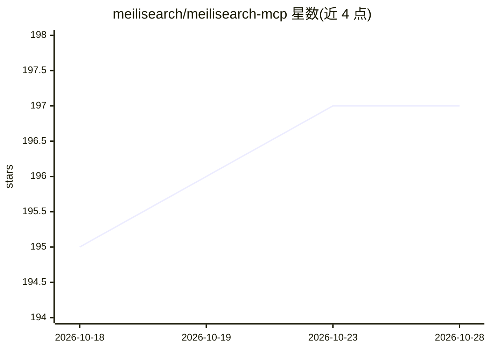

# meilisearch/meilisearch-mcp

⭐ 198 · Python · MIT · 推送 2026-10-28 · [GitHub](https://github.com/meilisearch/meilisearch-mcp) · 组织维护

**让 LLM 通过 MCP 协议操作 Meilisearch 搜索引擎的服务器**

基于 stdio 传输的 Model Context Protocol 服务器，使 Claude Desktop、OpenAI agents 等任何 MCP 兼容客户端能以自然语言管理 Meilisearch：创建/删除索引、增删文档、单/多索引搜索（含向量语义与混合搜索）、配置排序与过滤规则、管理 API 密钥、监控任务与健康状态，并可动态切换连接的 Meilisearch 实例。要求 Python ≥ 3.10 与一个运行中的 Meilisearch 实例，通过 pip/uvx/Docker 提供。限制：聊天中直接改主机与密钥的方式面向开发场景，README 注明不满足 MCP 安全最佳实践，生产环境需额外防护。

## 筛选速览

| 维度 | 判定 | 备注 |
|---|---|---|
| AI 角色 | `ai-ecosystem` | LLM/agent 周边工具 |
| 许可风险 | `permissive` | MIT |
| 部署形态 | `self-host` | docker 或自建部署 |
| 模型依赖 | — | README 未给出锁定关系 |
| 硬件要求 | — | 无带数字的原话,不猜 |
| 安装摩擦 | `low` | 无编译、无系统依赖或容器化 |
| 成熟度 | — | 结构信号不足 |

## 能力要点

- MCP 工具覆盖索引、文档、搜索、设置、API 密钥与任务监控
- 支持单/多索引搜索、向量语义搜索与混合搜索
- 动态切换 Meilisearch 实例连接
- 基于官方 MCP Python SDK v2，所有返回数据的工具同时提供 structuredContent

## 适用场景

- 在 Claude Desktop 等 MCP 客户端中用对话管理 Meilisearch 索引与文档
- 让 AI 助手执行带过滤、排序的多索引搜索
- 在 n8n 等容器化工作流中以 Docker 镜像接入搜索能力

## 场景标签

 · 领域:LLM 基础设施/搜索集成

## 证据(README 行号)

> L20: The Meilisearch MCP Server is a Model Context Protocol server that enables any MCP-compatible client (including Cla
> L28: - 📡 **stdio Transport** - Currently uses stdio; native Meilisearch MCP support coming soon!

## 星数曲线

2026-10-18 195 → 2026-10-28 197（+2）

---
*卡片 v1 · prompt 1.4 · 生成 2026-10-22 · 置信度 mid · 依据 README sha `02d2a35e54e8` · [字段定义](../../DATASET.md)*
