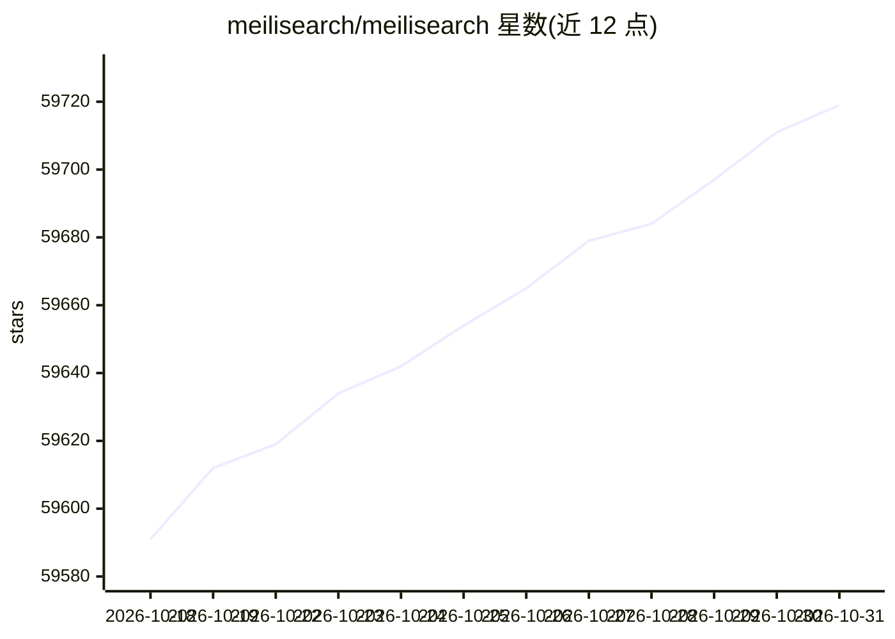

# meilisearch/meilisearch

⭐ 59,719 · Rust · NOASSERTION · 推送 2026-10-29 · [GitHub](https://github.com/meilisearch/meilisearch) · [官网](https://www.meilisearch.com) · 组织维护

**面向应用与网站的开源搜索引擎，提供全文/语义/混合搜索 API**

开源搜索引擎（MIT，Community Edition），以 RESTful API 提供全文、语义与混合搜索，支持容错、过滤分面、地理搜索、多租户、排序与同义词。AI 相关能力包括基于索引数据的对话式搜索（AI 生成回答）、原生 MCP 服务器（/mcp，实验性）、LangChain 向量存储集成。运行方式包括托管云服务与自托管（Docker、二进制、Homebrew、APT）；另有需商业协议的 Enterprise Edition（分片等）。由法国公司 Meili 开发。

## 筛选速览

| 维度 | 判定 | 备注 |
|---|---|---|
| AI 角色 | `ai-enhanced` | 去掉 AI 部分产品仍成立 |
| 许可风险 | `none` | NOASSERTION |
| 部署形态 | `desktop` | 安装包/桌面程序 |
| 模型依赖 | — | README 未给出锁定关系 |
| 硬件要求 | — | 无带数字的原话,不猜 |
| 安装摩擦 | `low` | 无编译、无系统依赖或容器化 |
| 成熟度 | `idea` | |

## 动量与使用信号

- 维护:`active` — 距上次 push 2.7 天,年发版 63,229 位贡献者
- 涨星:近 1 天 **+10**(自 20261016 起算)
- 平台:— · 协议:MCP

## 能力要点

- 全文/语义/混合搜索，支持容错与 50 毫秒内搜索即输即显
- 原生 MCP 服务器（实验性）与 LangChain 向量存储集成
- 对话式搜索：基于索引数据生成自然语言回答
- 优化支持中文、日文等多种语言的分词

## 适用场景

- 为网站或应用接入带容错的站内搜索
- 电商场景做多租户、分面过滤搜索
- 作为 RAG / AI agent 的检索后端（MCP、LangChain）
- 为 LLM 与编码代理提供文档（llms.txt）

## 场景标签

`语义搜索` · 领域:知识与检索

## 证据(README 行号)

> L22: Meilisearch is a search engine for fast, relevant full-text, semantic, and hybrid search. The easiest way to get st
> L87: - **Hybrid search:** Combine the best of both semantic & full-text search to get the most relevant results
> L99: - **Conversational search:** let users ask questions in natural language and get AI-generated answers grounded in y

## 星数曲线

2026-10-18 59,591 → 2026-10-31 59,719（+128）

---
*卡片 v1 · prompt 1.4 · 生成 2026-10-20 · 置信度 high · 依据 README sha `25bf1ffe0c7b` · [字段定义](../../DATASET.md)*
