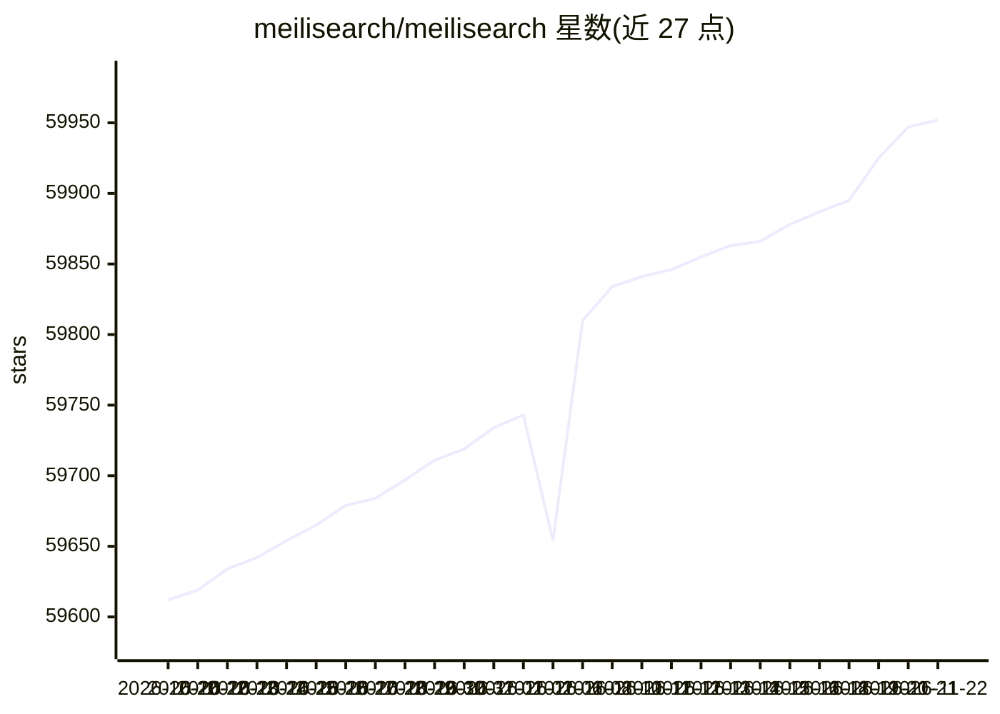

# meilisearch/meilisearch

⭐ 59,952 · Rust · NOASSERTION · 推送 2026-11-20 · [GitHub](https://github.com/meilisearch/meilisearch) · [官网](https://www.meilisearch.com) · 组织维护

**面向应用/网站开发者的开源搜索引擎 API，含 AI 混合检索**

Meilisearch 是一个全文、语义与混合搜索引擎，以 RESTful API 提供服务，供开发者嵌入自己的应用或网站。核心机制包括异步索引、拼写容错、过滤/分面、地理检索、API key 权限与多租户，并支持对话式检索（基于索引数据生成回答）与原生 MCP server。官方推荐通过 Meilisearch Cloud 托管使用，也可用 Docker、安装脚本、Homebrew 等自托管单个二进制。引擎分两个版本：社区版 MIT 开源，企业版含分片等高级功能但生产使用需商业协议。

## 筛选速览

| 维度 | 判定 | 备注 |
|---|---|---|
| AI 角色 | `ai-enhanced` | 去掉 AI 部分产品仍成立 |
| 许可风险 | `none` | NOASSERTION |
| 部署形态 | `desktop` | 安装包/桌面程序 |
| 模型依赖 | — | README 未给出锁定关系 |
| 硬件要求 | — | 无带数字的原话,不猜 |
| 安装摩擦 | `low` | 无编译、无系统依赖或容器化 |
| 成熟度 | — | 结构信号不足 |

## 动量与使用信号

- 维护:`active` — 距上次 push 2.7 天,年发版 63,229 位贡献者
- 涨星:近 1 天 **+10**(自 20261016 起算)
- 平台:— · 协议:MCP

## 能力要点

- 混合检索：语义搜索与全文搜索结合
- 内置拼写容错与毫秒级输入即搜
- 原生 MCP server（/mcp 路由）供 AI agent 直接查询索引
- 多语言支持，含中文/日文优化

## 适用场景

- 给自己的网站或应用加站内搜索
- 电商网站做过滤、分面、排序搜索
- 用自然语言问答基于自家索引数据返回回答
- 为 AI agent / RAG 提供检索层

## 场景标签

`语义搜索` · 领域:知识与检索

## 证据(README 行号)

> L27: Meilisearch is a search engine for fast, relevant full-text, semantic, and hybrid search. The easiest way to get st
> L92: - **Hybrid search:** Combine the best of both semantic & full-text search to get the most relevant results
> L104: - **Conversational search:** let users ask questions in natural language and get AI-generated answers grounded in 

## 星数曲线

2026-10-20 59,612 → 2026-11-22 59,952（+340）

---
*卡片 v1 · prompt 1.4 · 生成 2026-11-22 · 置信度 mid · 依据 README sha `174529f1f71e` · [字段定义](../../DATASET.md)*
