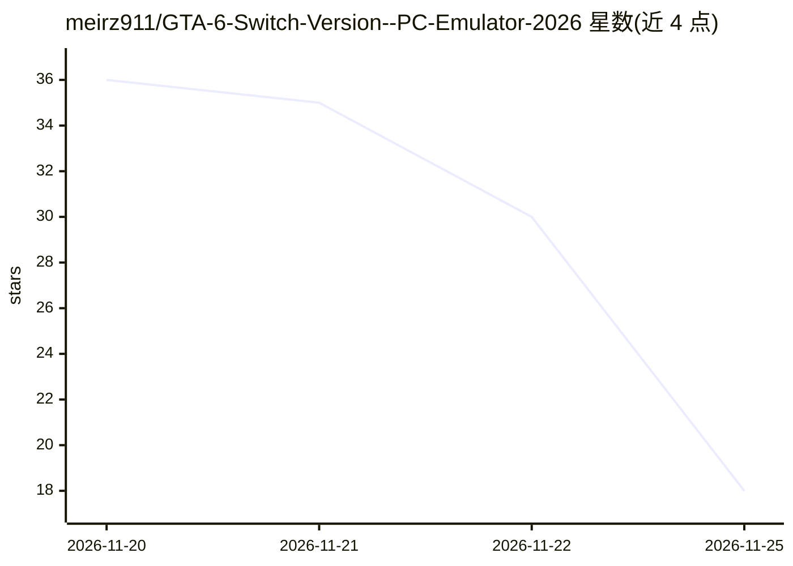

# meirz911/GTA-6-Switch-Version--PC-Emulator-2026

⭐ — · [GitHub]() · 个人维护

**面向 Windows 玩家的 GTA VI PC 版安装准备与配置指南**

一个面向 Windows 10/11 用户的 GTA VI PC 版信息与准备类仓库：提供系统兼容性检查清单（Windows 版本、DirectX、显卡驱动、存储空间）、图形与 FPS 优化说明、安装故障排查分类和分步准备教程。仓库自带的"installer"为独立的 Windows 配套工具（.exe），声明不包含或安装 GTA VI 游戏文件；游戏本体需经授权渠道获取。官方 PC 发售日期与硬件要求截至文档标注日期尚未公布，相关表格标记为未确认。

## 筛选速览

| 维度 | 判定 | 备注 |
|---|---|---|
| AI 角色 | `ai-knowledge` | 知识聚合/清单类 |
| 许可风险 | `permissive` | — |
| 部署形态 | `desktop` | 安装包/桌面程序 |
| 模型依赖 | — | README 未给出锁定关系 |
| 硬件要求 | — | 无带数字的原话,不猜 |
| 安装摩擦 | `low` | 无编译、无系统依赖或容器化 |
| 成熟度 | `idea` | |

## 能力要点

- Windows 兼容性准备清单（系统版本/DirectX/驱动/存储检查）
- 图形设置与 FPS 优化、卡顿与显示问题的排查说明
- 声明配套安装器不含游戏文件，游戏需授权渠道获取
- 官方系统要求表标注为"未确认"待更新

## 适用场景

- 为未来 GTA VI PC 版提前检查和准备 Windows 环境
- 排查 PC 游戏常见的低帧率、卡顿与显示问题
- 查找 Rockstar 官方资源与启动器链接

## 场景标签

 · 领域:游戏/指南资源

## 证据(README 行号)

> L5: A dedicated PC installation and configuration resource for Grand Theft Auto VI, covering Windows preparation, graphi
> L49: The companion installer does not contain or install GTA VI game files.

## 星数曲线

2026-11-20 36 → 2026-11-25 18（-18）

---
*卡片 v1 · prompt 1.4 · 生成 2026-11-20 · 置信度 mid · 依据 README sha `6954d37a13d3` · [字段定义](../../DATASET.md)*
