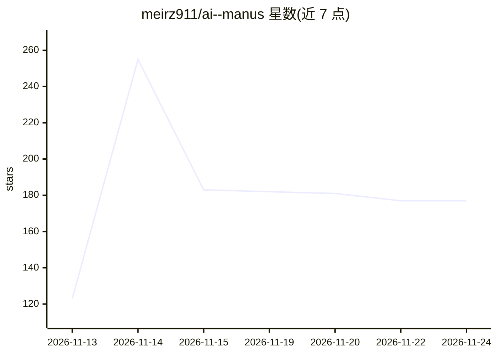

# meirz911/ai--manus

⭐ 173 · Apache-2.0 · 推送 2026-11-19 · [GitHub](https://github.com/meirz911/ai--manus) · 个人维护

**面向个人用户的自主 AI Agent：自动执行代码与浏览器操作**

README 描述 Manus 为可代替用户执行任务的自主体：自主编写并运行脚本、控制浏览器（导航网页、填写表单、收集信息）、完成多步骤任务，可在后台作为个人助手响应学习、家庭与轻量办公场景。README 声明其面向小规模个人使用而非企业平台，并给出 CPU/内存等兼容性配置表（最低 4GB 内存）。但 README 未提供任何安装命令、API 接入方式或源码运行说明，也未给出具体模型/provider 接入细节，功能仅停留在描述层面。

## 筛选速览

| 维度 | 判定 | 备注 |
|---|---|---|
| AI 角色 | `ai-native` | 本体是模型或模型工具 |
| 许可风险 | `permissive` | Apache-2.0 |
| 部署形态 | `None` |  |
| 模型依赖 | — | README 未给出锁定关系 |
| 硬件要求 | — | 无带数字的原话,不猜 |
| 安装摩擦 | `low` | 无编译、无系统依赖或容器化 |
| 成熟度 | — | 结构信号不足 |

## 能力要点

- 自主执行代码：agent 自行编写并运行脚本完成任务
- 浏览器控制：导航网页、填表、收集信息
- 多步骤任务处理，可在后台作为个人助手运行
- 声明面向家庭、学习与轻量工作等小规模场景

## 适用场景

- 让 agent 代为执行重复性的脚本与网页操作
- 学习研究中收集参考资料、整理笔记
- 远程办公时从多个页面汇总信息

## 场景标签

`AI 助手` `浏览器自动化` · 领域:效率与自动化

## 证据(README 行号)

> L10: - **Autonomous Code Execution:** Manus AI agent runs code on its own to complete tasks, so you can focus on decisio
> L18: Manus is an autonomous AI agent designed to run code and control a browser on your behalf. Instead of acting like a

## 星数曲线

2026-11-13 123 → 2026-11-24 177（+54）

---
*卡片 v1 · prompt 1.4 · 生成 2026-11-18 · 置信度 low · 依据 README sha `0eccc6fbe733` · [字段定义](../../DATASET.md)*
