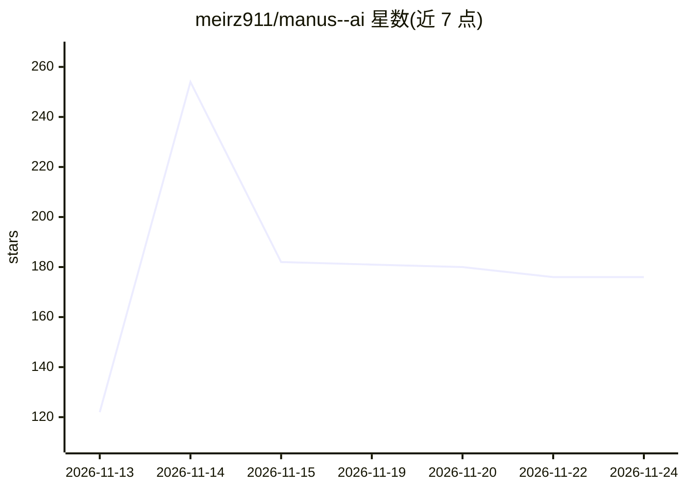

# meirz911/manus--ai

⭐ 176 · Apache-2.0 · 推送 2026-11-19 · [GitHub](https://github.com/meirz911/manus--ai) · 个人维护

**面向个人用户的自主 AI Agent：代为执行代码与浏览器操作**

README 描述 Manus 为自主 AI Agent，可在用户授权下运行脚本、控制浏览器（导航网页、填写表单、抓取信息）并执行多步任务，定位为家用、学习与轻量办公的个人助手，提供跨会话的任务模式记忆。说明采用下载安装的桌面形态，给出最低 4 GB 内存、双核 CPU 的兼容性要求，以及准备-配置-测试-细化的使用流程；README 未提供源码构建、API 接入或部署细节。

## 筛选速览

| 维度 | 判定 | 备注 |
|---|---|---|
| AI 角色 | `ai-native` | 本体是模型或模型工具 |
| 许可风险 | `permissive` | Apache-2.0 |
| 部署形态 | `None` |  |
| 模型依赖 | — | README 未给出锁定关系 |
| 硬件要求 | — | 无带数字的原话,不猜 |
| 安装摩擦 | `low` | 无编译、无系统依赖或容器化 |
| 成熟度 | — | 结构信号不足 |

## 能力要点

- 自主运行代码与多步任务执行
- 浏览器控制：导航、填表、信息收集
- 跨会话记住工作流模式并重复应用
- README 给出最低 4 GB 内存 / 双核 CPU 要求

## 适用场景

- 帮我自动收集多个网页的资料并整理笔记
- 重复表单填写和页面检查交给代理执行
- 学习或轻办公中把小脚本运行和日常琐事自动化

## 场景标签

`AI 助手` `浏览器自动化` · 领域:效率与自动化

## 证据(README 行号)

> L18: Manus is an autonomous AI agent designed to run code and control a browser on your behalf. Instead of acting like a
> L35: ## Compatibility
> L41: |**Memory (RAM)**|4 GB|8 GB or more for heavy Manus autonomous tasks|

## 星数曲线

2026-11-13 122 → 2026-11-24 176（+54）

---
*卡片 v1 · prompt 1.4 · 生成 2026-11-20 · 置信度 low · 依据 README sha `cc442405184f` · [字段定义](../../DATASET.md)*
