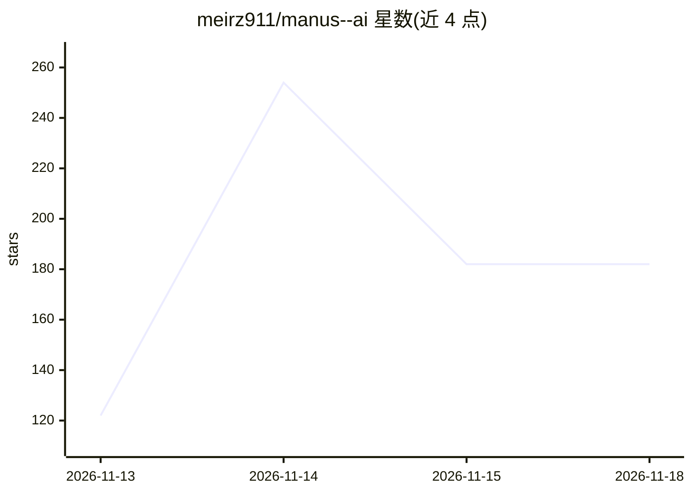

# meirz911/manus--ai

⭐ 182 · Apache-2.0 · 推送 2026-11-17 · [GitHub](https://github.com/meirz911/manus--ai) · 个人维护

**自主 AI Agent：代用户执行代码与控制浏览器完成任务**

面向家庭、学习与轻量办公场景的自主 AI Agent 宣传页：声称可代用户编写并执行脚本、控制浏览器（导航网页、填写表单、采集信息），并执行多步骤自动化任务，减少重复性手动操作。README 以功能介绍和使用建议为主，给出系统兼容性参考表（最低双核 CPU、4 GB 内存）与上手步骤，但未提供安装命令、源码结构或 API 接入方式，实际交付形态（桌面程序/服务）无法从文中确认。目标用户为非开发者的普通消费者与小项目使用者。

## 筛选速览

| 维度 | 判定 | 备注 |
|---|---|---|
| AI 角色 | `ai-native` | 本体是模型或模型工具 |
| 许可风险 | `permissive` | Apache-2.0 |
| 部署形态 | `None` |  |
| 模型依赖 | — | README 未给出锁定关系 |
| 硬件要求 | — | 无带数字的原话,不猜 |
| 安装摩擦 | `low` | 无编译、无系统依赖或容器化 |
| 成熟度 | — | 结构信号不足 |

## 能力要点

- 自主执行代码与脚本
- 浏览器控制（导航、填表、信息采集）
- 多步骤任务自动化，代码与浏览器操作可衔接
- 跨会话保持任务模式一致性

## 适用场景

- 让学生整理研究笔记、跑快速计算
- 让远程工作者从多个网页收集数据
- 把重复性小任务（查页面、整理文件）交给后台代理

## 场景标签

`浏览器自动化` `编码 Agent` · 领域:效率与自动化

## 证据(README 行号)

> L10: - **Autonomous Code Execution:** Manus AI agent runs code on its own to complete tasks, so you can focus on decisio
> L18: Manus is an autonomous AI agent designed to run code and control a browser on your behalf. Instead of acting like a

## 星数曲线

2026-11-13 122 → 2026-11-18 182（+60）

---
*卡片 v1 · prompt 1.4 · 生成 2026-11-18 · 置信度 low · 依据 README sha `0eccc6fbe733` · [字段定义](../../DATASET.md)*
