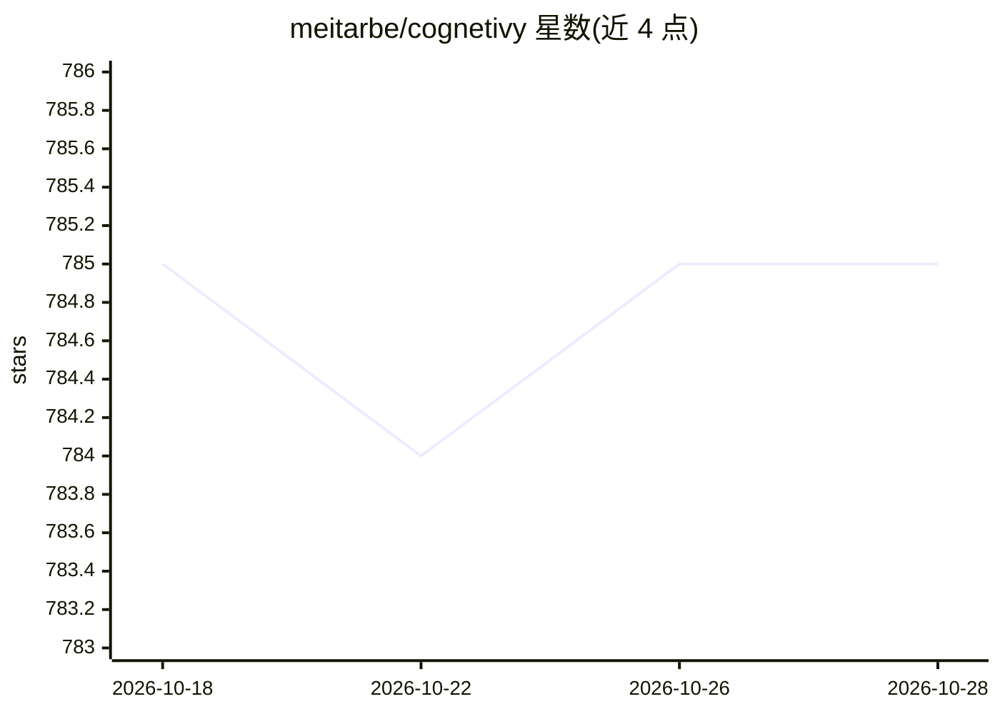

# meitarbe/cognetivy

⭐ 785 · TypeScript · MIT · 推送 2026-05-09 · [GitHub](https://github.com/meitarbe/cognetivy) · [官网](https://cognetivy.com) · 个人维护

**给 AI 编程 agent 的本地状态层：把会话变成可追踪工作流**

面向 AI 编程 agent 的状态与编排层：以工作流（workflows）、运行（runs）、事件（events）与集合（collections）组织 agent 过程。默认启动本地 studio（HTTP+WebSocket 服务器、内置浏览器 UI 与本机 executor），可视化设计与检查工作流并推进运行；也可用 CLI 操作工作流模板与运行步骤。状态存储在项目下 .cognetivy/ 目录，登录后支持云同步。提供 TypeScript/JavaScript API。要求 Node.js ≥ 18，MIT 许可。

## 筛选速览

| 维度 | 判定 | 备注 |
|---|---|---|
| AI 角色 | `ai-ecosystem` | LLM/agent 周边工具 |
| 许可风险 | `permissive` | MIT |
| 部署形态 | `library` | 以包/库形式分发 |
| 模型依赖 | — | README 未给出锁定关系 |
| 硬件要求 | — | 无带数字的原话,不猜 |
| 安装摩擦 | `low` | 无编译、无系统依赖或容器化 |
| 成熟度 | — | 结构信号不足 |

## 能力要点

- 本地 studio：浏览器 UI + 本机 executor 推进 runs 与节点
- workflows/runs/events/collections 四层结构化状态记录
- CLI 与 UI 共享同一工作流索引，支持云同步
- 提供 npx 一次性运行与全局安装两种方式

## 适用场景

- 把编程 agent 的会话固化为可重复、可审计的本地工作流
- 团队对本地 agent 输出做可追溯记录与结果对比
- 以可视化方式设计和迭代 agent 工作流

## 场景标签

`工作流自动化` `Agent 框架` · 领域:Agent 开发

## 证据(README 行号)

> L12: **Reasoning orchestration for agents:** durable **workflows**, **runs**, **events**, and **collections** - with a *
> L22: - **Define how it should work** with explicit workflows
> L27: In short: Cognetivy turns powerful-but-chaotic agent sessions into structured, auditable workflows.

## 星数曲线

2026-10-18 785 → 2026-10-28 785（+0）

---
*卡片 v1 · prompt 1.4 · 生成 2026-10-21 · 置信度 high · 依据 README sha `f8a58e4f211b` · [字段定义](../../DATASET.md)*
