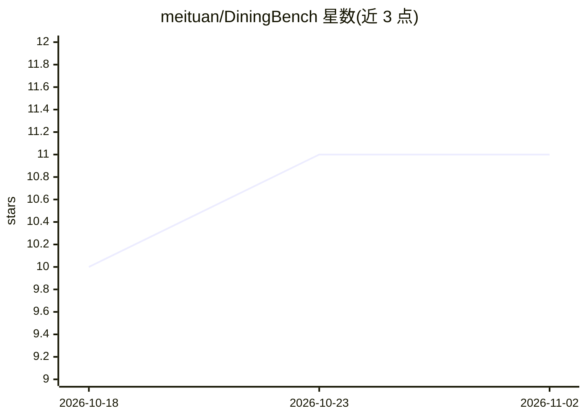

# meituan/DiningBench

⭐ 11 · Python · 推送 2026-04-14 · [GitHub](https://github.com/meituan/DiningBench) · 组织维护 · 中文 README

**面向饮食领域的 VLM 分层多视角评测基准**

ACL 2026 论文官方实现。DiningBench 是一个评测视觉语言模型的分层多视角基准，覆盖细粒度分类、营养估计与视觉问答三个认知层级；数据集含 3,021 道菜品、平均每条 5.27 张图像，纳入来自同一菜单的细粒度难负样本与经核验的营养数据。论文对 29 个开源与闭源模型进行了评测，并分析多视角输入与思维链的影响，归纳出五种主要失败模式。仓库提供评测脚本与基于 vLLM 的开源模型推理流程，数据集托管于 Hugging Face。面向进行 VLM 评测的科研用户。

## 筛选速览

| 维度 | 判定 | 备注 |
|---|---|---|
| AI 角色 | `ai-knowledge` | 知识聚合/清单类 |
| 许可风险 | `none` | — |
| 部署形态 | `library` | 以包/库形式分发 |
| 模型依赖 | local-ok | 支持本地模型 |
| 硬件要求 | — | 无带数字的原话,不猜 |
| 安装摩擦 | `low` | 无编译、无系统依赖或容器化 |
| 成熟度 | — | 结构信号不足 |

## 能力要点

- 细粒度分类 / 营养估计 / 视觉问答三层评测任务
- 3,021 道菜品、平均 5.27 图/条，含同菜单难负样本与核验营养数据
- 覆盖 29 个开源与闭源模型的评测结果
- 提供分类、营养、VQA 三套推理与评测脚本

## 适用场景

- 评测 VLM 在食物图像上的细粒度识别能力
- 测试模型对食物营养数据的估计准确性
- 在饮食领域 VQA 任务上对比模型表现

## 场景标签

`模型评测` `科研工具` · 领域:评测与运维

## 证据(README 行号)

> L1: # DiningBench: A Hierarchical Multi-view Benchmark for Perception and Reasoning in the Dietary Domain
> L11: >Recent advancements in Vision-Language Models (VLMs) have revolutionized general visual understanding. However, th

## 星数曲线

2026-10-18 10 → 2026-11-02 11（+1）

---
*卡片 v1 · prompt 1.4 · 生成 2026-11-02 · 置信度 high · 依据 README sha `686e6fdb3fe4` · [字段定义](../../DATASET.md)*
