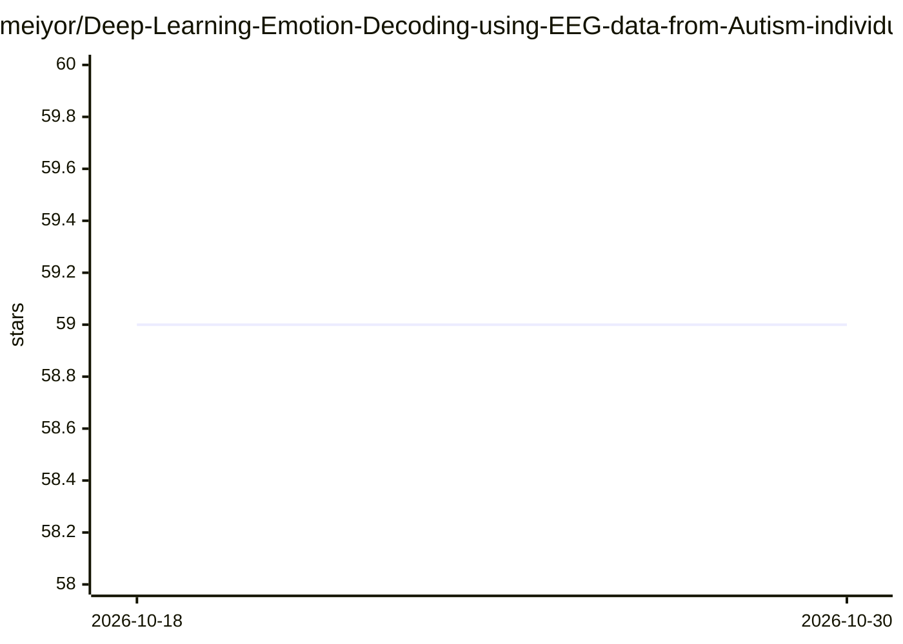

# meiyor/Deep-Learning-Emotion-Decoding-using-EEG-data-from-Autism-individuals

⭐ 59 · Python · 推送 2026-03-28 · [GitHub](https://github.com/meiyor/Deep-Learning-Emotion-Decoding-using-EEG-data-from-Autism-individuals) · [官网](https://www.lernerlab.com/) · 组织维护

**用 CNN 对自闭症群体 EEG 数据做情绪解码的科研代码**

包含 Python 与 MATLAB 代码的研究仓库：将 EEG 转为展平的 2D 图像输入定制卷积神经网络，对自闭症谱系（ASD）与对照组个体观看面部情绪刺激时的情绪进行解码。Python 部分提供 Leave-One-Trial-Out 交叉验证基线分类器与基于 iNNvestigate 的显著图/相关性分析（13 种 XAI 方法），MATLAB 部分读取性能输出文件。需自备经 ADJUST 预处理去除伪影的 EEG csv 数据，数据需向 Stony Brook 实验室申请。

## 筛选速览

| 维度 | 判定 | 备注 |
|---|---|---|
| AI 角色 | `ai-native` | 本体是模型或模型工具 |
| 许可风险 | `none` | — |
| 部署形态 | `None` |  |
| 模型依赖 | — | README 未给出锁定关系 |
| 硬件要求 | — | 无带数字的原话,不猜 |
| 安装摩擦 | `low` | 无编译、无系统依赖或容器化 |
| 成熟度 | — | 结构信号不足 |

## 能力要点

- LOTO 交叉验证的 CNN 情绪分类基线代码
- iNNvestigate 集成：13 种显著性/相关性图方法（LRP、DeepTaylor、Integrated Gradients 等）
- MATLAB 代码读取分类器性能输出
- 样本结果来自 88 名 ADOS-2 诊断参与者（48 对照、40 ASD）

## 适用场景

- 复现论文中 ASD 与对照组的 EEG 情绪解码实验
- 用自有 EEG 数据做情绪分类与 LOTO 交叉验证
- 对 CNN 情绪解码结果做 XAI 相关性图分析

## 场景标签

`科研工具` · 领域:学习与行业

## 证据(README 行号)

> L3: This repository includes the python and matlab codes using for processing EEG 2D images on
> L4: a customized Convolutional Neural Network (CNN) to decode emotion visual stimuli on individuals with and without

## 星数曲线

2026-10-18 59 → 2026-10-30 59（+0）

---
*卡片 v1 · prompt 1.4 · 生成 2026-10-24 · 置信度 high · 依据 README sha `e120725328bc` · [字段定义](../../DATASET.md)*
