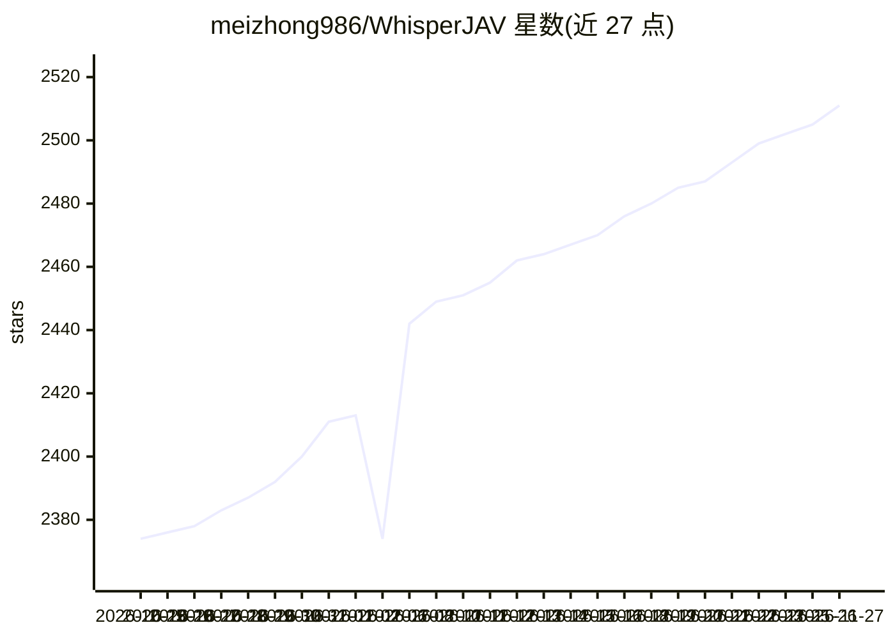

# meizhong986/WhisperJAV

⭐ 2,511 · Python · MIT · 推送 2026-11-23 · [GitHub](https://github.com/meizhong986/WhisperJAV) · [官网](https://github.com/meizhong986/WhisperJAV/releases/latest) · 个人维护 · 中文 README

**本地运行的日语成人视频字幕生成工具，抗噪声与幻觉**

WhisperJAV 是面向日语成人视频（JAV）的语音识别与字幕生成工具，本地运行、不上传媒体。针对长录音低信噪比、非语言发声干扰与 Whisper 类模型的漂移幻觉三类失效模式，采用场景切分、VAD 钳制与防御性解码后处理（幻觉/重复行移除、日语文本重组、时间轴修复）。支持 GUI 与 CLI，输出 SRT/WebVTT，提供单管道与双通道 ensemble 合并模式。Windows 有安装包，也可通过 Colab/Kaggle 笔记本运行。

## 筛选速览

| 维度 | 判定 | 备注 |
|---|---|---|
| AI 角色 | `ai-native` | 本体是模型或模型工具 |
| 许可风险 | `permissive` | MIT |
| 部署形态 | `desktop` | 安装包/桌面程序 |
| 模型依赖 | local-ok | 支持本地模型 |
| 硬件要求 | `gpu-8g` | |
| 安装摩擦 | `high` | 编译与系统依赖俱全 |
| 成熟度 | — | 结构信号不足 |

## 能力要点

- 场景切分 + VAD 钳制 + 置信阈值过滤的幻觉防御管线
- 可互换后端：Qwen3-ASR、anime-whisper、Faster-Whisper、HF Whisper、九条 GGUF (CrispASR) 管道
- 双通道 ensemble 合并（pass1/pass2、6 种合并策略、GUI 预设）
- 日语感知后处理：终助词/相槌/方言重组与纯拟声行移除

## 适用场景

- 为长篇日语视频批量生成 SRT 字幕
- 对嘈杂/低信噪比音频做抗幻觉转写
- 在 Colab/Kaggle 免费算力上跑转写流程
- 按敏感度与管道组合实验不同音频素材的识别效果

## 场景标签

`语音识别` · 领域:感知与多模态

## 证据(README 行号)

> L13: A subtitle generator for Japanese Adult Videos. Free, runs on your own machine, no cloud upload of your media.
> L29: - **Scene-based segmentation** — split the audio at natural acoustic boundaries so the model always processes a coh
> L69: - **The ASR model** turns speech into text.

## 星数曲线

2026-10-25 2,374 → 2026-11-27 2,511（+137）

---
*卡片 v1 · prompt 1.4 · 生成 2026-11-23 · 置信度 mid · 依据 README sha `6c6b35b33625` · [字段定义](../../DATASET.md)*
