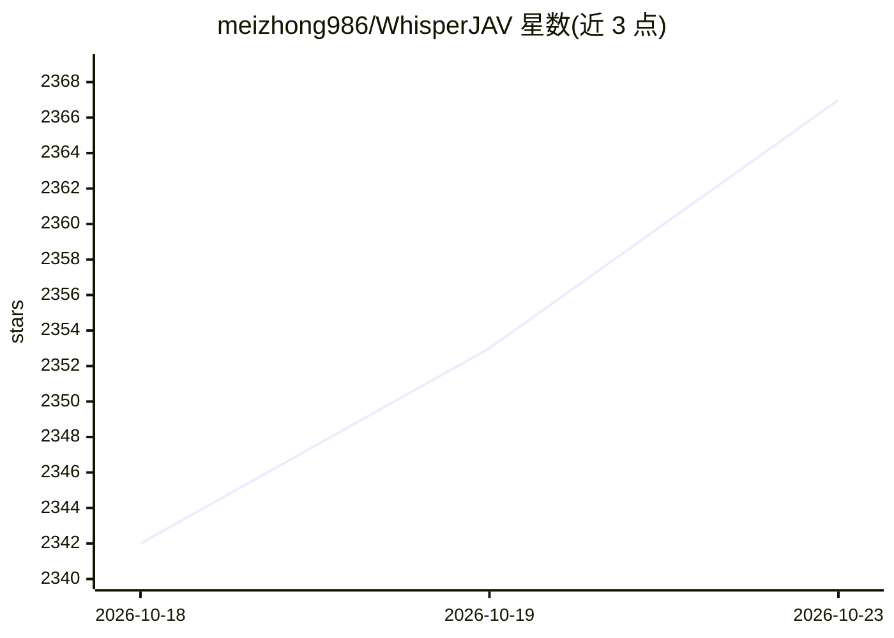

# meizhong986/WhisperJAV

⭐ 2,367 · Python · MIT · 推送 2026-10-12 · [GitHub](https://github.com/meizhong986/WhisperJAV) · [官网](https://github.com/meizhong986/WhisperJAV/releases/latest) · 个人维护 · 中文 README

**面向 JAV 的本地日文语音字幕生成器（ASR/STT）**

在本地为日本成人视频生成 SRT/WebVTT 字幕的桌面与命令行工具，不上传媒体到云端。针对低信噪比、非语言发声与长音频幻觉三类失败模式设计：按场景切分音频、VAD 钳制只送入真实语音、置信度阈值过滤与日文感知后处理。可选两遍集成流水线（如 Qwen3-ASR + FireRedVAD / Anime-Whisper + TEN VAD）、htdemucs 等语音增强（仅用于 VAD）、Ollama/DeepSeek/Gemini 翻译。支持 Windows 安装包、GUI、CLI、Colab/Kaggle 笔记本；输入依赖 FFmpeg 可读的音视频格式。

## 筛选速览

| 维度 | 判定 | 备注 |
|---|---|---|
| AI 角色 | `ai-native` | 本体是模型或模型工具 |
| 许可风险 | `permissive` | MIT |
| 部署形态 | `desktop` | 安装包/桌面程序 |
| 模型依赖 | — | README 未给出锁定关系 |
| 硬件要求 | — | 无带数字的原话,不猜 |
| 安装摩擦 | `high` | 编译与系统依赖俱全 |
| 成熟度 | — | 结构信号不足 |

## 能力要点

- 场景切分 + VAD 钳制 + 防御式解码抑制幻觉
- 两遍集成流水线：Qwen3-ASR/Anime-Whisper 配 FireRedVAD/TEN VAD
- htdemucs 语音增强仅驱动 VAD，识别仍用原始音频
- 运行结束输出 done/empty/suspect/failed 状态表与覆盖率（MILEAGE）

## 适用场景

- 为日文长视频本地生成带时间轴的字幕，不上传云端
- 处理低信噪比、含大量非语言发声的音频并抑制幻觉字幕
- 批量转写字件夹内视频并按字幕格式输出 SRT/WebVTT

## 场景标签

`语音识别` · 领域:感知与多模态

## 证据(README 行号)

> L13: A subtitle generator for Japanese Adult Videos. Free, runs on your own machine, no cloud upload of your media.
> L29: - **Scene-based segmentation** — split the audio at natural acoustic boundaries so the model always processes a coh
> L30: - **VAD clamping** — detect where speech actually is, and feed the model only that, with measured padding. This is 

## 星数曲线

2026-10-18 2,342 → 2026-10-23 2,367（+25）

---
*卡片 v1 · prompt 1.4 · 生成 2026-10-21 · 置信度 high · 依据 README sha `748278eccc01` · [字段定义](../../DATASET.md)*
