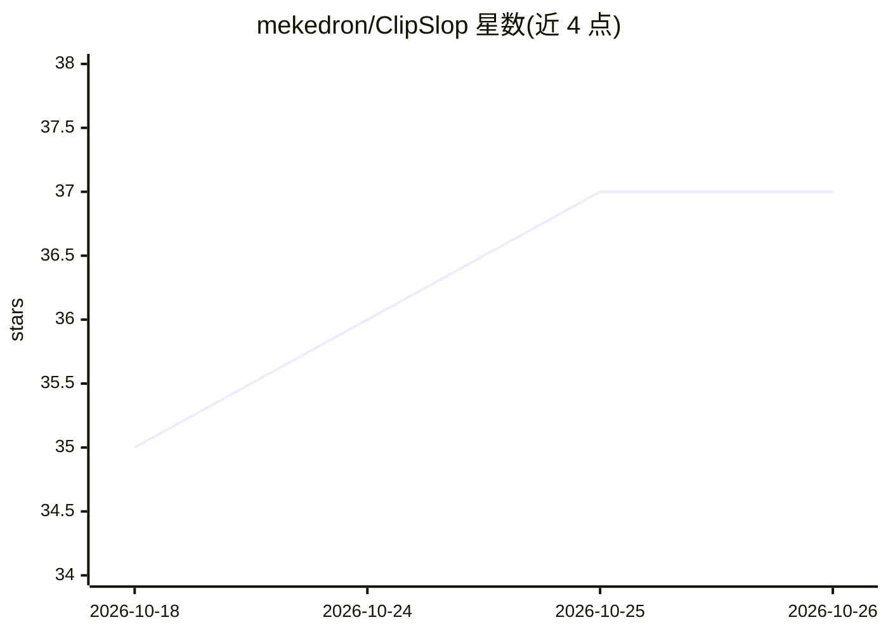

# mekedron/ClipSlop

⭐ 37 · Swift · MIT · 推送 2026-07-28 · [GitHub](https://github.com/mekedron/ClipSlop) · [官网](https://mekedron.github.io/ClipSlop/) · 个人维护

**macOS 全局快捷键 AI 文本改写工具：选中文本一键修语法/翻译/排版**

面向 macOS 用户的 AI 写作辅助应用：在任意应用中选中文本、按全局快捷键即可完成语法修正、翻译（18 语言）、改写（7 语气）、格式化（邮件/Markdown）等转换，结果原位粘贴回。支持将多个提示词串联为流水线，每步保存为历史节点、可回溯与分支。提供商覆盖 ChatGPT 免费登录、OpenAI API、Anthropic、Ollama 本地模型及任意 OpenAI 兼容接口；另有基于 Apple Vision 的屏幕 OCR、Settings Assistant 聊天式配置管理与 iCloud 同步。仅支持 macOS，提供下载安装包。

## 筛选速览

| 维度 | 判定 | 备注 |
|---|---|---|
| AI 角色 | `ai-native` | 本体是模型或模型工具 |
| 许可风险 | `permissive` | MIT |
| 部署形态 | `desktop` | 安装包/桌面程序 |
| 模型依赖 | local-ok | 支持本地模型 |
| 硬件要求 | — | 无带数字的原话,不猜 |
| 安装摩擦 | `low` | 无编译、无系统依赖或容器化 |
| 成熟度 | — | 结构信号不足 |

## 能力要点

- Inline Run：全局快捷键捕获选中文本、运行提示词、原位粘贴结果
- 提示词流水线：多步串联，历史节点可回溯与分支
- 多提供商：ChatGPT 登录/OpenAI API/Anthropic/Ollama/OpenAI 兼容接口
- Apple Vision 端上屏幕 OCR（⇧⌘2），OCR 后可继续串联转换

## 适用场景

- 写邮件或文档时用快捷键即时修语法、调语气
- 将文本按'改写→翻译→格式化'串联成一条转换流水线
- 对图片或不可复制文本做屏幕 OCR 后翻译、总结
- 用 Ollama 本地模型完成文本转换而不联网

## 场景标签

`AI 写作` `OCR` · 领域:内容生成

## 证据(README 行号)

> L12: ClipSlop is a free, open-source AI writing tool for macOS that works in any app. Fix grammar, translate text, rewri
> L115: - **Inline Run** — Assign a global hotkey to any prompt. Captures selected text, runs the prompt, pastes the resul
> L121: - **Multi-provider** — OpenAI (sign in with ChatGPT or API key), Anthropic, Ollama, CLI tools, any OpenAI-compatib

## 星数曲线

2026-10-18 35 → 2026-10-26 37（+2）

---
*卡片 v1 · prompt 1.4 · 生成 2026-10-25 · 置信度 high · 依据 README sha `61f24a38dba1` · [字段定义](../../DATASET.md)*
