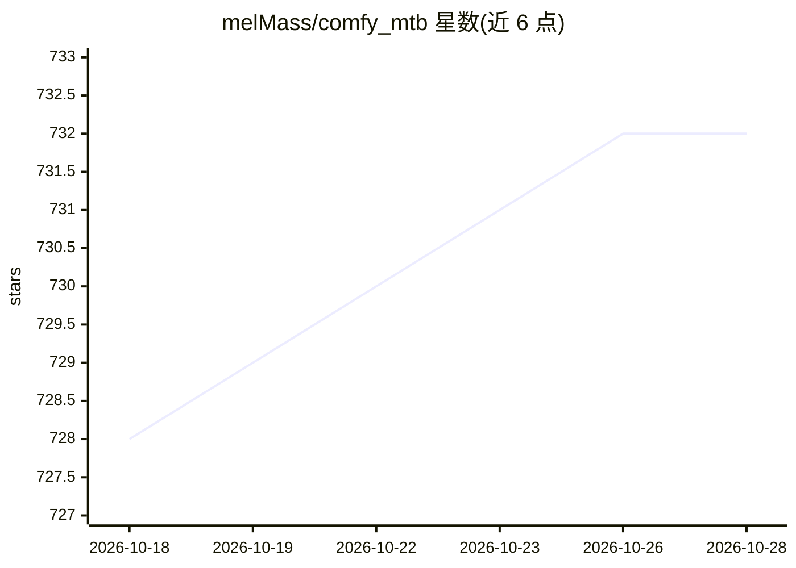

# melMass/comfy_mtb

⭐ 732 · Python · MIT · 推送 2026-07-04 · [GitHub](https://github.com/melMass/comfy_mtb) · 个人维护

**面向动画的 ComfyUI 节点包（插值、换脸等）**

为 ComfyUI 提供的动画方向自定义节点集合，主题标签涵盖插值、换脸、动画与 stable-diffusion 相关处理。README 本体内容很少：仅说明 master/main 分支暂处过时状态以保持向后兼容，下一版本在 dev/0.6.0 分支开发，并链接 Wiki、安装指南与示例文档。具体节点功能、安装命令与依赖不在可见 README 中，需查阅其链接的 Wiki 与 Install Guide。维护者通过 Buy Me A Coffee 接受捐赠。

## 筛选速览

| 维度 | 判定 | 备注 |
|---|---|---|
| AI 角色 | `ai-ecosystem` | LLM/agent 周边工具 |
| 许可风险 | `permissive` | MIT |
| 部署形态 | `None` |  |
| 模型依赖 | — | README 未给出锁定关系 |
| 硬件要求 | — | 无带数字的原话,不猜 |
| 安装摩擦 | `low` | 无编译、无系统依赖或容器化 |
| 成熟度 | `idea` | |

## 能力要点

- 面向动画场景的 ComfyUI 自定义节点包（插值、换脸等标签）
- 下一版本在 dev/0.6.0 分支开发，主干暂保持向后兼容
- 提供 Wiki、安装指南与示例的文档链接

## 适用场景

- 在 ComfyUI 工作流中补充动画相关处理节点
- 查看示例了解节点用法

## 场景标签

`图像生成` `图像视频处理` · 领域:内容生成

## 证据(README 行号)

> L1: # MTB Nodes

## 星数曲线

2026-10-18 728 → 2026-10-28 732（+4）

---
*卡片 v1 · prompt 1.4 · 生成 2026-10-21 · 置信度 low · 依据 README sha `9ada4a95c073` · [字段定义](../../DATASET.md)*
