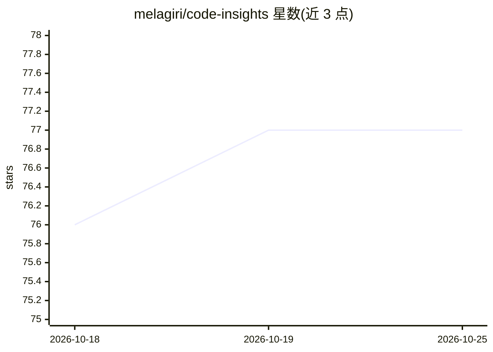

# melagiri/code-insights

⭐ 77 · TypeScript · MIT · 推送 2026-06-01 · [GitHub](https://github.com/melagiri/code-insights) · [官网](https://code-insights.app) · 个人维护

**把 AI 编程会话转为可浏览知识的本地分析 CLI**

面向开发者的本地优先 CLI：读取 Claude Code、Cursor、Codex CLI、Copilot CLI 与 VS Code Copilot Chat 五种工具的会话数据，提取带权衡的决策、带根因的学习记录与五维提示词质量评分，并做跨会话模式综合，可导出规则到 CLAUDE.md/.cursorrules。数据存于本机 SQLite，通过终端统计与内置 dashboard 查看，含活动图表与按项目/模型的成本分解。LLM 分析可用自有 API key 或自动检测的本地 Ollama（推荐 llama3.3）。

## 筛选速览

| 维度 | 判定 | 备注 |
|---|---|---|
| AI 角色 | `ai-ecosystem` | LLM/agent 周边工具 |
| 许可风险 | `permissive` | MIT |
| 部署形态 | `library` | 以包/库形式分发 |
| 模型依赖 | local-ok | 支持本地模型 |
| 硬件要求 | — | 无带数字的原话,不猜 |
| 安装摩擦 | `low` | 无编译、无系统依赖或容器化 |
| 成熟度 | — | 结构信号不足 |

## 能力要点

- 支持 5 种 AI 编程工具的会话数据自动发现与解析
- 五维提示词质量评分与前后对照反馈
- 每周跨会话综合：摩擦点、有效模式、可导出规则
- 本地 SQLite 存储，支持 Ollama 零 API key 分析与 Claude Code hook 零配置接入

## 适用场景

- 回顾并改进自己与 AI 结对编程的提示词和工作习惯
- 跨会话发现摩擦点与有效模式，沉淀为编辑器规则文件
- 在终端或 dashboard 中查看各 AI 工具的使用与成本分布

## 场景标签

`提示工程` · 领域:Agent 开发

## 证据(README 行号)

> L20: Analyzes your sessions from **Claude Code, Cursor, Codex CLI, Copilot CLI, and VS Code Copilot Chat** to extract st
> L42: Each session is analyzed to extract structured insights — decisions with trade-offs and alternatives, learnings wit

## 星数曲线

2026-10-18 76 → 2026-10-25 77（+1）

---
*卡片 v1 · prompt 1.4 · 生成 2026-10-24 · 置信度 high · 依据 README sha `c5972a65639d` · [字段定义](../../DATASET.md)*
