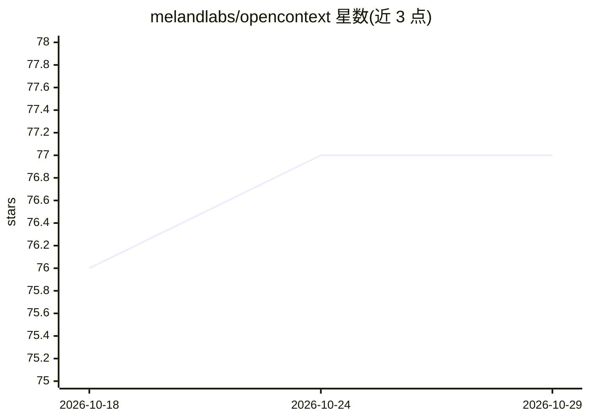

# melandlabs/opencontext

⭐ 77 · TypeScript · Apache-2.0 · 推送 2026-10-23 · [GitHub](https://github.com/melandlabs/opencontext) · [官网](https://openloomi.ai) · 组织维护 · 中文 README

**给 AI agent 开发者的时序上下文图与记忆运行时库**

面向构建 agent 应用的团队，以单一 npm 依赖提供时序上下文图（事实带 valid_from/valid_until，修正为追加式）、记忆 API、检索原语（sqlite-vec/pgvector/Chroma 后端适配）、确定性 Loop 调度引擎、跨平台集成层（Slack/Telegram/飞书等）与审计加密存储。使用方式包括嵌入库、CLI、HTTP 守护进程、MCP 服务器及 DeepSeek Harness 插件。附自测基准分数（注明非 AML 官方结果）。

## 筛选速览

| 维度 | 判定 | 备注 |
|---|---|---|
| AI 角色 | `ai-ecosystem` | LLM/agent 周边工具 |
| 许可风险 | `permissive` | Apache-2.0 |
| 部署形态 | `library` | 以包/库形式分发 |
| 模型依赖 | — | README 未给出锁定关系 |
| 硬件要求 | — | 无带数字的原话,不猜 |
| 安装摩擦 | `low` | 无编译、无系统依赖或容器化 |
| 成熟度 | — | 结构信号不足 |

## 能力要点

- 时序上下文图：每条事实带 valid_from/valid_until，修正为追加式而非破坏性
- 确定性 Loop 引擎：LLM 调用是最后一步而非基础，仅在确有工作时唤醒
- 检索原语支持 sqlite-vec / pgvector / Chroma 后端混用
- 以 DSH 插件形式暴露 16 个 oc_* 工具并按轮次注入历史上下文

## 适用场景

- 为跨渠道办公助手保留同一份持久记忆
- 工程团队查询『上个季度我们相信什么』这类可引用的历史决策
- 受审计领域（金融/法律/医疗）留存逐事实溯源与合规证据
- 多 agent 工作流用调度器确定性唤醒而非常驻 LLM 循环

## 场景标签

`Agent 记忆` · 领域:Agent 开发

## 证据(README 行号)

> L23: **OpenContext** is the agentic context runtime that sits underneath an agentic
> L53: |🪶|**Library-First API**|Install once with `pnpm add @melandlabs/opencontext` and get the contracts, memory store, 

## 星数曲线

2026-10-18 76 → 2026-10-29 77（+1）

---
*卡片 v1 · prompt 1.4 · 生成 2026-10-24 · 置信度 high · 依据 README sha `d094b6d29dc0` · [字段定义](../../DATASET.md)*
